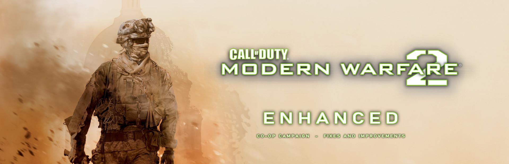

<p align="center"><b>English</b> · <a href="README.ru.md">Русский</a></p>

<p align="center">
  
</p>

<p align="center">
  <a href="https://github.com/stxlvn/mw2_enhanced/releases/latest"></a>
  <a href="https://www.nexusmods.com/codmw2/mods/99"></a>
  
  
  
  <a href="LICENSE"></a>
</p>

<h3 align="center">Modern Warfare 2 (2009), made better. Play the whole campaign with a friend.</h3>

<p align="center">
  <b>Modern Warfare 2 Enhanced</b> is a mod for the original 2009 game on the current <b>64-bit Steam build</b>, in the spirit of <a href="https://github.com/alicealys/h2-mod">h2-mod</a>. It starts with what the game lacks most: <b>two-player co-op for the whole campaign</b>, online or on one PC in <b>split screen</b> (new, experimental), built on the co-op netcode the game already ships for Spec Ops. Fixes and improvements of the game itself are added as they are found.<br>
  <a href="https://github.com/stxlvn/mw2_enhanced/releases/latest"><b>⬇ Download the latest release</b></a> · <a href="https://www.nexusmods.com/codmw2/mods/99">Nexus Mods</a> · <a href="#install">Install</a> · <a href="#known-issues">Known issues</a>
</p>

<p align="center">
  <a href="https://discord.gg/q882kMMEY"></a>
</p>

---

## ✨ Features

### 🤝 Co-op campaign

- 🤝 **The real campaign, for two.** Both PCs run the same level in lockstep, so the world, the enemies and every scripted scene are shared, not faked.
- 🎬 **Every set piece reworked for two players**: vehicles, turrets, climbs, swims, cutscenes and the final knife fight. Nobody is left behind or thrown out of a scene.
- 🎯 **Enemies fight both of you**, and scenes that protect the player protect both.
- 🩹 **Downs and revives** with the game's own revive system; both down means a restart together.
- 🎚 **One difficulty for both**: the one the host picks in the lobby.
- 🔫 **Friendly fire switch**: the host turns damage between the players on or off in the lobby (on by default).
- 🚩 **Checkpoints in every mission**: a failed mission starts again from the last section you both reached.
- 🧭 **Hosting and joining in the game's menus**: Campaign → co-op lobby, mission select, open / Steam friends only / password, a list of games on the network, join by address or Steam invite.
- 🌐 **Online made easy**: an in-game Windows Firewall prompt and automatic UPnP port forwarding for the host.
- 🖥 **Split screen on one PC (new, experimental)**: Campaign → Split screen puts both players in one game window, cut top and bottom like the Xbox 360 version, each half with its own view, weapon, HUD and effects. Each player picks his device in the lobby by pressing a button on it (keyboard and mouse, or a gamepad); a gamepad gets the console layout, aim assist, vibration, its buttons in the hints and its own options page. The names over the players read Alpha and Bravo.
- 🎞 **Loads like single player**: the campaign's loading screen with the mission's briefing film; online, the level waits for the film until it ends or either player skips it.
- 💾 **Saves for each playthrough, kept by the host**: each save remembers who played it. "Continue" picks up your partner's playthrough, "Pick a save" lists them (mission and players); playing on with someone new asks first: add them to the playthrough, or start a new game from the beginning. Both move on to the next mission together, and each player's own campaign records (missions unlocked, difficulty, achievements) are written as in single player.
### 🛠 Fixes and improvements of the game

- 🔤 **Fonts closer to the English original (Russian game)**: the Russian build draws everything in one generic sans; the mod swaps in the H*-Mod fonts (a Bank Gothic like face for the headings, a Conduit like one for the running text, a bold one for the mission intro text; SIL OFL; `mw2coop\fonts`). Off with `fonts=0` in `settings.ini`; the English game is not touched.
- 📝 **Russian text fixes**: the Favela Escape objective no longer names Captain Price before he has appeared in the story (wording from the h2-mod translation). More are welcome as issues.
- ⌨️ **Developer console**: the key left of 1 (~) opens the MW2 Enhanced console in every build (the retail game has none). It has Enhanced and Legacy layouts; Legacy defaults to half the game-client width, inset 16 px from the top and left edges. The window can be moved and resized from its left, right and bottom edges (with diagonal resizing at the bottom corners); its collapsed title bar can also be dragged, as can blank portions of the output and status strips. Double-clicking the title bar maximizes/restores it, while a short 220 ms click delay distinguishes single clicks. The input row has a persistent Pause mode toggle immediately left of the editable text field (off and grey by default); the header keeps local time with seconds in the Windows regional 12/24-hour format and minimize/maximize/close controls. When Pause mode pauses a game that was previously running, a large subdued watermark appears behind the console output (`|| Game pause activated` in English, `|| Игра приостановлена` in Russian); it is not shown when the game was already paused before opening. When enabled, opening the console queues `cl_paused 1`; closing queues `cl_paused 0` only when the game was not already paused at open. Pause mode captures mouse input while the console is open so pointer movement over the overlay cannot move the in-game menu cursor. It includes command and dvar search, value-aware Tab completion, including current-value queries with `*=%value%` (also supports vector values containing spaces), command history, word selection by double-click, clipboard support, output/suggestion scrollbars, and multiline input that grows upward without resizing the window. Autocomplete remains inside the console in Enhanced layout; Legacy prefers a scrollable dropdown below the window and uses a side popup only when no vertical placement can show a suggestion row. When a command is submitted while the user is scrolled back, a short-lived notification appears below the console's lower-right corner with recent output, while the historical scrollback remains a single viewport. The console never teleports the physical cursor: in relative/captured mouse mode it draws a software pointer from captured Raw Input, while in unrestricted/menu mode it uses the native Windows pointer. Raw Input is consumed when delivered to the game window or a safely subclassed same-process auxiliary window; registrations owned by another process are left untouched. The title bar shows a move cursor only during an active left-button drag; resize edges use matching resize cursors, and clickable autocomplete suggestions use a hand cursor. The overlay scales proportionally to the game window's Windows DPI. Command echoes use `]`, while the editable input uses a yellow `> ` prompt. The `version` dvar value appears without a label in the expanded window's subdued bottom status bar, not in the output log. The autocomplete popup is slightly darker than the main panel; button tooltips use a solid opaque surface. Header, resize-grip and collapsed-state vector glyphs use coverage antialiasing; console text uses grayscale GDI antialiasing to avoid coloured ClearType fringes on the alpha overlay. The status value is shortened with an ellipsis when the window is too narrow. Command totals use number-first forms in Russian (`1 команда`, `5 команд`, `23 команды`) and English (`1 command`, `5 commands`). Includes `cmdlist`, `dvarlist`, `dvardump`, `find`, and `condump`. QoL tools include output search (`Ctrl+F`, `F3`, `Shift+F3`), prefix-aware Up/Down history, click-to-pin dvar suggestions with no fixed count limit; new/upgraded profiles seed `mapname` and `viewposNow` once, favorites occupy dedicated rows below the real status bar, with up to four dvars per row; a partially filled row expands its items across the full available width to reduce value truncation, and values update live for scalar and vector dvars (including FLOAT2/FLOAT3/FLOAT4 and colour vectors; visible rows are naturally limited by the game-window height). Favorites are unframed text, not buttons: hovering a favorite reveals a small unpin glyph at its right edge, and only that glyph is clickable; the label itself keeps the normal arrow cursor. Right-click is not required to unpin. (`watch`, `unwatch`, and `watchlist` remain available as command alternatives.) Also includes `dvarcompare <name>` for current/default/latched comparison. Triple-click selects an output row; the output context menu has `Copy Line`. The new-output toast can be clicked to jump to the latest lines or dismissed with its close glyph. Layout, window geometry, UI language, Pause mode, dvar pins are saved in `mw2coop\settings.ini` (`[console] pause_mode=0|1`; default `0`).
- 🖼 **Windowed full screen by default (`borderless=1`)**: the game's exclusive full screen is made a borderless window of the whole screen, so Alt+Tab no longer loses the graphics device (it froze the partner in co-op, crashed the game afterwards and, in split screen, on the way back). `borderless=0` brings the game's own full screen back.
- 🔭 **Upscalers (experimental, off by default; FSR 3 and DLSS are 64-bit only)**: the game renders below the window size and the picture is upscaled: AMD **FSR 1** (`upscale=1`), AMD **FSR 3** (`fsr3=1`; motion vectors are rebuilt from the game's depth, and AMD's DLLs are not shipped, see `settings.ini`) and NVIDIA **DLSS** (`dlss=1`, GeForce RTX; its bridge DLL is built apart from this repository because of NVIDIA's license, see [`src/dlss/README.md`](src/dlss/README.md)). FSR 3 and DLSS run on **Direct3D 9 on 12** (`d3d9on12=1`, the game's Direct3D 9 on top of Direct3D 12), which can also be used alone. Measured on a laptop with an RTX 3060: they do not add FPS at 1080p, because this game is limited by the CPU there (the graphics card is about a third busy); they are for picture quality and for graphics cards that are the limit.
- 🎛 **Session options in `[gameplay]`** (fall damage, jump height, gravity; the host's values go to the other player) and a **network guard** (`guard=1`, on by default) that drops packets no co-op session sends.
- 🧩 **Nothing of the game replaced**: one `winmm.dll` and a `mw2coop` folder; scripts are patched in memory when they load.

## 🎮 Missions

| Mission | Reworked for two |
|---|---|
| S.S.D.D. | both start in the range's sandbag bay; each takes his own rifle, pistol and frags |
| Team Player | Shepherd's opening for both; first to the glowing seat is the gunner, the other rides along (no seat swapping); ride end and crash for both |
| Cliffhanger | side-by-side ice climb with your own icepicks, the big jump (Soap catches each of you), a snowmobile each, the helicopter waits for both |
| No Russian | both in Makarov's crew look; own place in the elevator; the cover and the line of fire count for either player; the ending shoots both |
| Takedown | both ride the opening car; each ducks on his own key |
| Wolverines! | player 2 rides in the opening and closing Humvees |
| The Hornet's Nest, Exodus | both start together; Exodus' laser designator goes to one random player |
| The Only Easy Day... | an SDV each, both surface; whoever strikes first does the stealth kill; in split screen both screens follow the level's colour changes (player 2 used to stay underwater-blue) |
| The Gulag | both fly in on the helicopter's door |
| Of Their Own Accord / Second Sun | Blackhawk ride for both, both wake up in the crash, side by side at the ISS, a falling helicopter chases each of you |
| Whiskey Hotel | a flare for each player on the roof |
| The Enemy of My Enemy | player 2 rides the UAZ's back seat into the C-130 |
| Loose Ends | Shepherd's betrayal for both: you go through the ending as Roach, his shot hits both |
| Endgame | one drives the boat, the other shoots from the bow; whoever strikes Shepherd first plays the knife fight, the other watches |

All mission intros hold both players; the title plays only on a mission's first start.

## 🧭 Plans

Modern Warfare 2 Enhanced grows into an improvement mod for the original game, not only a co-op one: translation and font fixes, rendering fixes (for example the sharpness of downscaled text), quality of life. There are no dates; what is done is in the [changelog](CHANGELOG.md), ideas and bug reports go to [Issues](https://github.com/stxlvn/mw2_enhanced/issues).

<a id="install"></a>
## 📦 Install

> You both need **Call of Duty: Modern Warfare 2 (2009) on Steam**, the current **64-bit build**, and **the same version of the mod**.

1. Download `mw2coop-<version>.zip` from [Releases](https://github.com/stxlvn/mw2_enhanced/releases/latest).
2. Steam → Library → Modern Warfare 2 → ⚙ Manage → **Browse local files** (the folder with `iw4sp.exe`).
3. Copy `winmm.dll` and the `mw2coop` folder there. No game file is replaced.
4. **Host:** Campaign → co-op. Pick the mission and access in the lobby.
5. **Partner:** accept the host's Steam invite, or Campaign → join a game, then pick it from the list or type the host's address.
6. Both press **Ready**, the host presses **Start**.

> **Nightly builds:** with every new commit on `main` a test build (64-bit, 32-bit and iw4x-sp archives) is published as the pre-release [nightly](https://github.com/stxlvn/mw2_enhanced/releases/tag/nightly), replacing the previous one. It is only compiled, not played: back up your `mw2coop` folder and `winmm.dll` first, and expect bugs.

**Split screen on one PC:** Campaign → Split screen. Each player presses a button on the device he will play on (the cards Alpha and Bravo show it), then Start. The gamepad layout and options are in `INSTALL.txt`.

**Older 32-bit game:** take `mw2coop-<version>-x86.zip`; **iw4x-sp client:** `mw2coop-<version>-iw4x.zip` (experimental). Their `INSTALL.txt` says what was checked.

`INSTALL.txt` in the archive says the same in English and Russian. To uninstall, delete `winmm.dll` and the `mw2coop` folder.

## 🌐 Playing over the internet

The host needs UDP port **28960** reachable. The mod opens it on the router by itself when UPnP is on; otherwise forward the port or play over a shared VPN. The port can be changed in `mw2coop\settings.ini` (the same on both PCs).

No port forwarding, or a provider that does not allow it? Set `steam_relay=1` under `[network]` in `mw2coop\settings.ini` on both PCs and join through a Steam invite: the game traffic then goes through Steam, behind any router. Two players have played a mission this way.

Something wrong? Send `mw2coop\mw2coop.log` from both PCs, and see [how to write an issue](docs/reporting-issues.md).

<a id="known-issues"></a>
## ⚠️ Known issues

- Slow motion plays on both screens, whoever triggers it: both PCs run one game clock, so it cannot be shown to one player only.
- Checkpoints: bots fail the mission in every section of every campaign mission, 64-bit and 32-bit, and check that the level starts again with both players up and together (all pass). A restart goes to the level's own checkpoint, which is sometimes the section before the one you died in. Not tried by two people yet.
- Rarely (once in about a hundred mission loads, seen in the 32-bit build) both PCs hang right after a mission starts. A cause was found and fixed (see the changelog) but one hang does not prove it; if it happens, restart the mission and tell us.
- In the 32-bit builds (the older 32-bit game and the iw4x-sp client) the split screen crashed in 3 of 7 test runs when a level restarted, about 95 s after it began; the 64-bit build did not. A cause of such crashes in all builds was found and fixed on 2026-11-09 (player 2's half kept the previous level's state after a level change, see the changelog); after it a chain of four missions in a row ran in the 32-bit game, and a second fault of the level load (`iw4sp.exe+0xfb41b`, a missing name table entry) is guarded now (see the changelog). One longer 32-bit chain still crashed inside the NVIDIA driver (`nvd3dum.dll`); not looked into.
- Nobody has played the whole campaign through together yet: tell us how far you got.
- Cliffhanger, the big jump, split screen: in the bot test (`mw2coop_qa climb`) Soap catches both players one after the other in some runs, and in others player 2 falls past the cliff and fails the mission with "hold on tight" (3 runs of 5 fell); the bots' timing may be the cause, a real pair has not been seen to fall; not looked into, and not compared with an older build (v0.6.0 crashes before that, at the ice axes).
- Split screen: the characters around you (the team, the civilians) used to stop and jump in both halves; fixed in this version in all three builds (checked on No Russian: the actors that do not move in a frame fell from 20-35 % to under 1 %; not yet seen by two people).
- Split screen (new): tested with bots, screenshots of both halves and simulated gamepads, not yet with two real gamepads or by two people. Two sound listeners (each sound is heard from the nearer player's place, like on the console), no second keyboard, the second player can only pause (not work the menus); the game may not close by itself after quitting (end it in Task Manager).
- Gamepads: split screen and the lobby's device pick read XInput pads (Xbox and compatible). A PlayStation or other pad needs a wrapper that makes it an XInput pad (Steam Input, DS4Windows). With two different pads under Steam Input, turning Steam Input off for one of them has made both work in a similar project (MW2 Recompiled, its issue 5); not tried here. If a pad does not vibrate, check that Vibration is on in the game's own Controls options (the first thing it needed in that project's issue 8). Native PlayStation pad support is not there.
- The split screen of the 32-bit game (archive `-x86`) was checked with bots on the Trainer and Cliffhanger only. The iw4x-sp client (archive `-iw4x`) is experimental: checked with bots on the Trainer only.
- Upscalers (experimental): on the tested laptop FSR 3 and DLSS gave no FPS gain at 1080p (see above); DLSS was not yet checked for ghosting while turning. In the sandstorm of Team Player FSR 3 upscales the frame at the end, so its HUD is as soft as the picture. The 32-bit and iw4x-sp builds have FSR 1 only.
- A crash with both the Steam overlay and the Discord overlay on, after the game has created its graphics device again (a `vid_restart`, a change of the video options, in a test also a level start of the 32-bit game): the two overlays hook the same Direct3D 9 calls and call each other until the stack overflows (`mw2coop.log`: `CRASH: exception 0xc00000fd`, with `GameOverlayRenderer.dll` and `DiscordHook.dll` frames repeating). Not caused by the mod's own code as far as the log shows; turning one of the two overlays off avoids it.
- The Only Easy Day...: a report that the hostage assault fails by itself even when every enemy is dead is not located yet, and the tester could not repeat it (shooting the guards inside before the breach fails the mission by design; in his log the mission failed twice with the game's own "enemies alerted, hostages killed" message); if it happens, send `mw2coop\mw2coop.log` and say which room.

## 🧪 How it's tested

Two copies of the game on one PC (host + client), driven by in-game bots: each check scenario runs on both machines and reports PASS or FAIL. Bots press real buttons through the game's key bindings where it matters, and a level tour visits every start point with frames from both screens. The split screen is checked with the frames of both halves the mod composes and with scripted scenarios on simulated gamepads. Every fix comes with a test that failed before it and passes after. On GitHub every pull request runs a check of the patch files, the scripts and the repository's contents and builds the three archives, and every push to `main` builds the nightly archives; whether the patches apply to the game's own scripts is checked on the developer's PC (the game's files are not in the repository).

---

<details>
<summary>🛠 <b>For developers: how it works</b></summary>

- `winmm.dll` is a proxy: all 180 `winmm` exports go to the system DLL. `iw4sp.exe` imports `winmm.dll`, so Windows loads the proxy from the game folder. It refuses any game build it was not made for.
- Addresses come from reverse engineering the 64-bit build (Ghidra) and are listed with what they are in `src/game.h`, `src/scripts.c`, `src/scrdebug.c`.
- `Scr_AddSourceBuffer` is replaced: `mw2coop\scripts\<file>` adds or replaces a script, `mw2coop\patches\<file>.patch` edits the game's own script text when it loads. The mod never ships whole game scripts. Patch format: see `src/scripts.c`. If another mod already replaced the function, mw2coop chains it.
- `content/scripts/maps/_mw2coop.gsc` is the co-op campaign framework: campaign mode in a co-op session, keeping player 2 with player 1, weapon sync, checkpoints as level start points, restart when both players are down, the end of a mission. Scripts ask the host's DLL for actions (restart, save progress) through the dvar `mw2coop_cmd`.
- Saves: each PC would write and load its own save and break lockstep, so autosaves are off; progress is a level start point (`start` dvar) plus the host's save, `mw2coop\progress\save_<n>.txt` (mission, start point, members: each partner's id from his `mw2coop\player.ini`, Steam ID and name; see `src/progress.c`).
- In a co-op session GSC `getdvar` only returns dvars with certain flags; the DLL flags `start` and the QA dvars, and every dvar a level script sets itself, so levels that read back their own dvars behave as in single player.
- Difficulty: the lobby's popup only latches `g_gameskill`; the DLL hooks `profile_difficultySave` for the host's pick and sends it to the client with `coopLaunch`.
- Diagnostics in `mw2coop\mw2coop.log`: GSC errors with the script call stack (repeats logged at 1, 2, 3, 10, 100, 1000... hits), crashes with the faulting RVA and stack, `!trace <rva>` logs every call of a builtin method.
- Split screen: one game process runs two local players. The DLL keeps a second copy of the client state (view, HUD, effects system, input) and swaps it in for the second player's half every frame, then composes both halves into the window (`src/native.c`, `docs/native-splitscreen-plan.md`). The lobby picks each player's device from the first button pressed on it.
- The 32-bit mod (`sh build.sh x86`, `docs/32bit-plan.md`) and its iw4x-sp profile (`sh build.sh x86 iw4x`; iw4x-sp's 1.0.159 addresses are mapped in `src/addr159.c`, generated by `tools/gen_addr159.py`) ship as separate archives `mw2coop-<version>-x86.zip` and `mw2coop-<version>-iw4x.zip` (experimental) in each release.

</details>

<details>
<summary>⌨ <b>Hosting and joining by hand (console)</b></summary>

For testing, these lines go into `mw2coop\commands.txt`, which the mod runs in order (appended lines run as they arrive; `!sleep <ms>` waits). The game must show its online connection first (about 10 s after start).

Host:
```
set coop_mapName trainer
listen
coopLaunch
```
`coopLaunch` can be given early: the game starts the mission once the partner has joined. To carry on where you stopped, replace `set coop_mapName ...` with `mw2coop_continue`. The host sends the client the start point with `coopLaunch`. To pick a checkpoint by hand, `set start <start point>` before `coopLaunch`; `set mw2coop_god 1` turns the test god mode on (the client follows the host).

Client (`8305` is port 28960 byte-swapped; the game's `connect` expects it that way):
```
mw2coop_party_join
connect <host IP> 8305
```
`mw2coop_party_join` stands in for the Steam-lobby step of a normal invite.

</details>

<details>
<summary>🔧 <b>Build</b></summary>

Needs [llvm-mingw](https://github.com/mstorsjo/llvm-mingw) and a POSIX shell (Git Bash):
```
LLVM_MINGW=/path/to/llvm-mingw-ucrt-x86_64 ./build.sh release
```
`tools/make_release.sh <version> [x86|iw4x]` builds the release DLL (checked for local paths) and packs `dist/mw2coop-<version>.zip` with the scripts, patches and `content/release` (`INSTALL.txt`, `settings.ini`, the firewall helper), plus its SHA-256; `x86` and `iw4x` pack `mw2coop-<version>-x86.zip` (the older 32-bit game) and `mw2coop-<version>-iw4x.zip` (the iw4x-sp client). `tools/gen_winmm_proxy.py` regenerates the export stubs from the system `winmm.dll`.

Testers: use a **copy** of the game folder, not your Steam install, and start it with `SteamAppId=10180` and `SteamGameId=10180` set (without them the Steam DRM wrapper exits and Steam starts your **real** install instead); `tools/run_test.ps1` does this and kills any `iw4sp.exe` outside the test folder.

</details>

<details>
<summary>🧪 <b>Testing</b></summary>

`tools/qa_pair.sh <scenario> [start point] [seconds] [map]` starts a host and a client copy on one PC, connects them, runs an in-game check scenario on both (`content/scripts/maps/_mw2coop_qa.gsc`; Cliffhanger's climb in `_mw2coop_climb_qa.gsc`), prints both logs and closes the copies once the scenario is done. One Steam account is enough: the QA-only command `!xuid_add` gives the second copy a different player id. `MW2COOP_GOD` sets the test god mode (on by default in QA), `MW2COOP_HOST_CMDS` runs host-only lines before `coopLaunch`.

Scenarios:
- **Any map:** `spawn`, `leash`, `look` (players face each other for frames), `targets` (whom the enemies fight), `buttons` (real Forward and Use on each player's machine), `introfreeze`, `tour` (every start point of a level, real-input walk, triggers, frames from both screens).
- **Downs and difficulty:** `god`, `downs` (Recruit), `sceneskill` (a scene's threatbias and accuracy through a down and a revive), `skill` (the host's pick on both machines).
- **S.S.D.D.:** `intro`, `restart`, `end`, `resume` (`@continue`), `pickups`, `bay`.
- **Team Player:** `rkintro`, `board`, `rideend`, `turret`. **Wolverines!:** `ride`. **Takedown:** `takedown`, `takedown2`.
- **The Only Easy Day:** `oilrig`, `oilrig2`. **Cliffhanger:** `climb`, `snow`, `snowpick`.
- **No Russian:** `nrend`, `nrend2`, `cover`, `lineoffire`, `bodyview`. **Crash site / Second Sun:** `crashsite`, `dcemp`, `street`.
- **Whiskey Hotel:** `flares`. **Loose Ends:** `betrayal`. **Endgame:** `boat`, `boat2`, `knife`, `knife2`.

A scenario can press a player's buttons for real: `press( player, "activate", ms )` makes that player's own machine run the key binding (`mw2coop_bind +activate`, see `src/control.c`). Real key input runs in `buttons`, `pickups`, `introfreeze`, `bay`, `look`, `flares` and the tour's walk; the older set-piece scenarios still move players by script (button holds, velocity pushes) and have not been checked with real input. Split screen: `tools/qa_native.sh [seconds] [extra [native] lines]` runs one copy with both players in it and saves the composed frame; `MW2COOP_LOBBY=1` goes through the menus and the lobby with simulated gamepads (`MW2COOP_PAD`), other options are in the script's header. `tools/check_patches.py` checks the patches against extracted game scripts without starting the game; `tools/gen_*_patches.py` generate the larger patches from the extracted scripts.

</details>

## 🙏 Credits

Modern Warfare 2 Enhanced (`mw2coop` inside: the folder, the DLL's scripts and settings keep that name) is our own code, but it stands on other people's work:

- **[h2-mod](https://github.com/alicealys/h2-mod)** by alicealys and contributors: the model for this mod, and the source of the Russian wording of the Favela Escape objective.
- **COD-MOD** and its campaign co-op pack (`x_coop`, author unknown): the first MW2 campaign co-op, for the old 32-bit build. We checked how it handled each mission (where the players stand, the Whiskey Hotel flare) before building ours. The COD-MOD client is by momo5502 and contributors ([FreeTheTech101/cod-mod](https://github.com/FreeTheTech101/cod-mod)).
- **H\*-Mod fonts** (Vlad Loktionov, made for [h2-mod](https://github.com/alicealys/h2-mod); suggested in issue 1): the fonts of the Russian game's new look, SIL Open Font License 1.1 as stated in the files (the notes and the license text are in `mw2coop\fonts`).
- **[iw4x-sp](https://git.alterware.dev/alterware/iw4x-sp)** by AlterWare: read for how the engine handles player input and asset pools (reference only; no code taken).
- **Infinity Ward**: the game's own Spec Ops co-op, which the mod turns into a campaign mode.
- **[Co-op Anything](https://github.com/cranebeaker/coop-anything)**: the playbook and test tools this mod was built with.
- Tools: [Ghidra](https://github.com/NationalSecurityAgency/ghidra) (NSA), [llvm-mingw](https://github.com/mstorsjo/llvm-mingw) (Martin Storsjö), [Capstone](https://www.capstone-engine.org/), the [Steamworks documentation](https://partner.steamgames.com/doc/home), [shields.io](https://shields.io) badges.

## ⚖️ Legal

Not affiliated with or endorsed by Activision or Infinity Ward. Call of Duty and Modern Warfare are trademarks of Activision; the banner uses the game's Steam artwork and logo as a fan work. You need your own copy of the game; no game files are included. The mod's own code is MIT licensed (see `LICENSE`). Patch files quote short lines of the game's scripts only to say where a change goes; those lines belong to their owners and are not covered by the MIT license. The mod uses the game's co-op mode between players who agree to play together; it is not for multiplayer cheating.
