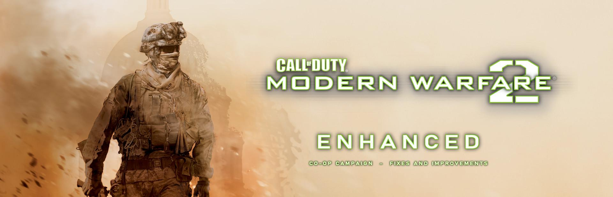

<p align="center"><b>English</b> · <a href="README.ru.md">Русский</a></p>

<p align="center">
  
</p>

<p align="center">
  <a href="https://github.com/stxlvn/mw2_enhanced/releases/latest"></a>
  <a href="https://www.nexusmods.com/codmw2/mods/99"></a>
  
  
  
  <a href="LICENSE"></a>
</p>

<h3 align="center">Modern Warfare 2 (2009), made better. Play the whole campaign with a friend.</h3>

<p align="center">
  <b>Modern Warfare 2 Enhanced</b> is a mod for the original 2009 game on the current <b>64-bit Steam build</b>, in the spirit of <a href="https://github.com/alicealys/h2-mod">h2-mod</a>. It starts with what the game lacks most: <b>two-player co-op for the whole campaign</b>, online or on one PC in <b>split screen</b> (new, experimental), built on the co-op netcode the game already ships for Spec Ops. Fixes and improvements of the game itself are added as they are found.<br>
  <a href="https://github.com/stxlvn/mw2_enhanced/releases/latest"><b>⬇ Download the latest release</b></a> · <a href="https://www.nexusmods.com/codmw2/mods/99">Nexus Mods</a> · <a href="#install">Install</a> · <a href="#known-issues">Known issues</a>
</p>

---

## ✨ Features

### 🤝 Co-op campaign

- 🤝 **The real campaign, for two.** Both PCs run the same level in lockstep, so the world, the enemies and every scripted scene are shared, not faked.
- 🎬 **Every set piece reworked for two players**: vehicles, turrets, climbs, swims, cutscenes and the final knife fight. Nobody is left behind or thrown out of a scene.
- 🎯 **Enemies fight both of you**, and scenes that protect the player protect both.
- 📍 **Markers for the partner (new)**: tap Z (a pad's Back) to mark what you look at for both of you: an enemy (a red marker over him that follows him), an enemy vehicle or gunner, a grenade or a mine, a barrel or car that explodes, a weapon on the ground (by name) or ammunition, or a place; twice quickly marks danger, pressed again on your own marker it goes away. Hold Z for the wheel: enemy, attacking, going here, wait here, danger, fall back, watching, covering; move the mouse (a pad's right stick) to one and let go, the view stays still meanwhile. A line on the screen says who marked what, and the marker speaks in your squad's own battle chatter ("contact at your 3 o'clock", "grenade!", the orders to suppress and to move), you and your partner in different voices. The key is set in `settings.ini` (`[input] ping_key`) or with `bind <key> +mw2coop_ping` in the console.
- 🩹 **Downs and revives** with the game's own revive system; both down means a restart together.
- 🎚 **Difficulty**: online, the one the host picks in the lobby, for both; in split screen each player picks his own (the rows Alpha and Bravo, like the console game's two difficulty buttons).
- 🔫 **Friendly fire switch**: the host turns damage between the players on or off in the lobby (on by default).
- 🚩 **The game's own checkpoints**: a failed mission goes back to the last checkpoint, as in single player, with the level, the enemies, the objectives and both players' weapons as they were (64-bit game and the iw4x-sp client; the older 32-bit game restarts at the section of the level instead).
- 🧭 **Hosting and joining in the game's menus**: Campaign → co-op lobby, mission select, open / Steam friends only / password, a list of games on the network, join by address or Steam invite.
- 🌐 **Online made easy**: an in-game Windows Firewall prompt and automatic UPnP port forwarding for the host.
- 🧭 **Where the partner is (new)**: the game's own arrow to him at the edge of the screen shows his distance in metres, so does his health icon while he needs reviving, and so do the marker wheel's markers ([display] marker_distance=0 in settings.ini: the icons alone). The marker wheel has **On me** (brings the partner beside you, outside the story's scenes) and **Need ammo** (your partner presses Use on you to hand over a magazine).
- 🎙 **Push-to-talk voice (new)**: hold CapsLock (`[voice] talk_key`) to talk to your partner in network co-op, no Discord needed.
- 💬 **Text chat (new)**: press T in a network co-op level, type, and Enter sends the line to your partner (Esc closes it, Ctrl+V pastes); both of you see it at the left of the screen. The key is set in `settings.ini` (`[chat] key`) or with `bind <key> mw2coop_chat` in the console.
- 🐞 **Report a bug (new)**: the pause menu's REPORT A BUG makes a zip in `mw2coop\reports` with both PCs' logs, a screenshot and the crash dump, private paths removed: attach it to an issue.
- 🔁 **Back after a broken connection (new)**: when the link breaks in a network mission, or one game closes or crashes, the host's lobby waits with the playthrough, the partner's game joins it again by itself, and both go on from the last checkpoint after a 5-second count (what was played since that checkpoint is lost, as after a failed mission). A game that closed meanwhile asks at its next start, within 30 minutes, whether to go on.
- 🖥 **Split screen on one PC (new, experimental)**: Campaign → Split screen puts both players in one game window, cut top and bottom like the Xbox 360 version, each half with its own view, weapon, HUD and effects. Each player picks his device in the lobby by pressing a button on it (keyboard and mouse, or a gamepad); a gamepad gets the console layout, aim assist, vibration, its buttons in the hints and its own options page. The names over the players read Alpha and Bravo. Each player is drawn in a renderer frame of his own, as on the console; Spec Ops runs in split screen too, with the console game's split-screen HUD, and Settings → Enhanced → "Players in opposite corners (as on consoles)" gives the console's own layout of two offset boxes.
- 🎞 **Loads like single player**: the campaign's loading screen with the mission's briefing film; online, the level waits for the film until it ends or either player skips it.
- 💾 **Saves for each playthrough, kept by the host**: each save remembers who played it. "Continue" goes on from the game's last checkpoint on both PCs, with the partner the playthrough was played with (64-bit game and the iw4x-sp client); "Pick a save" lists the playthroughs (mission and players); anyone else is offered a new game. Both move on to the next mission together, and each player's own campaign records (missions unlocked, difficulty, achievements) are written as in single player.
### 🛠 Fixes and improvements of the game

- 🔤 **Fonts closer to the English original (Russian game)**: the Russian build draws everything in one generic sans; the mod swaps in the H*-Mod fonts (a Bank Gothic like face for the headings, a Conduit like one for the running text, a bold one for the mission intro text; SIL OFL; `mw2coop\fonts`). Off with `fonts=0` in `settings.ini`; the English game is not touched.
- 📝 **Russian text fixes**: the Favela Escape objective no longer names Captain Price before he has appeared in the story (wording from the h2-mod translation). More are welcome as issues.
- 🧭 **A new main menu**: Campaign, Spec Ops, Multiplayer, Settings, Credits, About the mod, Quit, with the logo (and ENHANCED in its style) at the top of the left panel. The Campaign page has Continue, New game, Mission select, **Co-op**, **Split screen** and Statistics; Multiplayer is the game's own; About the mod lists the contributors and links to the source, Nexus Mods, PlayGround and Discord.
- ⌨️ **Developer console**: press the key left of `1` (`~`) to open the MW2 Enhanced console (the retail game has none). It offers Enhanced and Legacy layouts, a movable and resizable window, optional pause mode, command and dvar search with Tab completion and history, output search, and pinned dvar favorites with live values. Built-in commands include `cmdlist`, `dvarlist`, `dvardump`, `find`, `condump` and `dvarcompare`; the layout, window position and size, language, pause mode and favorites are saved in `mw2coop\settings.ini`.
- 🖼 **Windowed full screen by default (`borderless=1`)**: the game's exclusive full screen is made a borderless window of the whole screen, so Alt+Tab no longer loses the graphics device (it froze the partner in co-op, crashed the game afterwards and, in split screen, on the way back). `borderless=0` brings the game's own full screen back.
- 🪟 **A window that fits on the screen (new, 64-bit)**: in windowed mode the game took the screen's own size, so the title bar and frame went past the edges and under the taskbar; now such a window gets the largest display mode that fits, the same shape first (`[display] window_fit=1`). The 3D view keeps its proportions in any window shape.
- ⚡ **Faster level loads (new)**: the game makes the same Direct3D shaders again for every copy in a level and for the next level; the mod makes each once and gives it back (`[native] shadercache=1`, on by default): a level loaded again opens about a fifth faster.
- 🔫 **cg_weaponFov (new)**: the weapon's own field of view, apart from the view's: `cg_weaponFov 65` draws the weapon as the console game does at any `cg_fov`; 0 (the default) keeps the game's way. The muzzle flash stays on the barrel.
- 🔭 **Upscalers (experimental, off by default, 64-bit only)**: the game renders below the window size and the picture is upscaled: AMD **FSR 3** (`fsr3=1`; motion vectors are rebuilt from the game's depth) or NVIDIA **DLSS** (`dlss=1`, GeForce RTX). Settings → Enhanced → Upscaler picks one. FSR 3 and DLSS run on the mod's own DirectX 12 renderer (picking one in Settings → Enhanced sets the DirectX version to 12); the older layer of the game's Direct3D 9 on top of Direct3D 12 still works with `d3d9on12=1` in the file. Measured on a laptop with an RTX 3060: they do not add FPS at 1080p, because this game is limited by the CPU there (the graphics card is about a third busy); they are for picture quality and for graphics cards that are the limit. FSR 1 was removed on 2026-11-18 (owner: "superfluous").
  - **Where to get the DLLs** (the mod does not ship the vendors' files; put them in `mw2coop\fsr3` and `mw2coop\dlss` in the game folder, or name another folder with `fsr3_dir` / `dlss_dir` in `settings.ini`):
    - FSR 3: `amd_fidelityfx_loader_dx12.dll` and `amd_fidelityfx_upscaler_dx12.dll` from AMD's FidelityFX SDK on GitHub, folder [`Kits/FidelityFX/signedbin`](https://github.com/GPUOpen-LibrariesAndSDKs/FidelityFX-SDK/tree/7539ae8b6568ad29ed78a753404351daf3b5cca7/Kits/FidelityFX/signedbin) (checked with the SDK 2.4.0).
    - DLSS: the mod's bridge `mw2coop_dlss.dll` is the release's separate archive `mw2coop-dlss-<version>.zip` (it contains NVIDIA's SDK code: its `NOTICE-DLSS.txt` has NVIDIA's terms; how it is built: [`src/dlss/README.md`](src/dlss/README.md)); NVIDIA's `nvngx_dlss.dll` from NVIDIA's DLSS SDK on GitHub, folder [`lib/Windows_x86_64/rel`](https://github.com/NVIDIA/DLSS/tree/9981c6350dc58c0ce21f024fd65e31e851c31689/lib/Windows_x86_64/rel) (checked with DLSS 310.9.16).
- 🧩 **The mod's own DirectX 11 and 12 renderers (experimental, off by default, 64-bit only)**: Settings → Enhanced → DirectX version, or `directx11=1` / `directx12=1` under `[display]`. They replace the game's Direct3D 9 back end and add a flip-model swap chain with tearing and low latency, HDR, forced anisotropic filtering, an anti-aliasing override with alpha to coverage, a compiled-shader cache and, on DirectX 12 only, FSR 3 and DLSS (with motion vectors for moving characters and the weapon). Checked with bots on 8 campaign maps on each; the game's own Direct3D 9 stays the default. See the [changelog](CHANGELOG.md) and [`docs/native-dx-plan.md`](docs/native-dx-plan.md).
- 🎛 **Session options in `[gameplay]`** (fall damage, jump height, gravity; the host's values go to the other player) and a **network guard** (`guard=1`, on by default) that drops packets no co-op session sends.
- 🧩 **Nothing of the game replaced**: one `winmm.dll` and a `mw2coop` folder; scripts are patched in memory when they load.

## 🎮 Missions

| Mission | Reworked for two |
|---|---|
| S.S.D.D. | both start in the range's sandbag bay; each takes his own rifle, pistol and frags; the course's gates close once both have passed, either player's sprint counts |
| Team Player | Shepherd's opening for both; first to the glowing seat is the gunner, the other rides along (no seat swapping); no damage between you on the ride; ride end and crash for both |
| Cliffhanger | side-by-side ice climb with your own icepicks, the big jump (Soap catches each of you), a snowmobile each, the helicopter waits for both; both have the stealth visibility, the partner sees your whole snowmobile with you in the seat and, on the wall, your body climbing (the icepicks upright in the hands) |
| No Russian | both in Makarov's crew look; own place in the elevator; the cover and the line of fire count for either player; the ending shoots both |
| Takedown | both ride the opening car; each ducks on his own key |
| Wolverines! | player 2 rides in the opening and closing Humvees; either player's smoke grenade marks the BMP |
| The Hornet's Nest, Exodus | both start together; Exodus' laser designator goes to one random player (in split screen it comes on from a pad's d-pad) |
| Escape from Favela | the big jump across the gap (both jump, Soap reaches for each) and the helicopter's rope ladder: the first to jump starts the scene, the other grabs the same ladder; neither sees the other's arms over his own |
| The Only Easy Day... | an SDV each, both surface; whoever strikes first does the stealth kill; the hostage assault no longer fails while one player waits for the other; the escape helicopter takes both, side by side on the bench; in split screen both screens follow the level's colour changes (player 2 used to stay underwater-blue) |
| The Gulag | both fly in on the helicopter's door and both get off; the explosion in the night-vision hallway and the fall in the cafeteria knock both down; the rope in the cellblock (both go down in turn) and the rope evacuation to the Pave Low (each hooks up himself), each seeing the other's body, not a second pair of hands |
| Contingency | in split screen the Predator missile steers with a pad too |
| Of Their Own Accord / Second Sun | Blackhawk ride for both, the Barrett for whoever takes it, both wake up in the crash and walk slowly after the EMP, side by side at the ISS, a falling helicopter chases each of you |
| Whiskey Hotel | a flare for each player on the roof |
| The Enemy of My Enemy | player 2 rides the UAZ's back seat into the C-130 |
| Loose Ends | a mine each in the ambush on the way to the house; Shepherd's betrayal for both: you go through the ending as Roach, his shot hits both |
| Just Like Old Times | the rappel at the start: the first to hook up goes down and kills the guard below, the other follows, seen as a body doing Price's rappel; the collapse at the cave exit takes both |
| Endgame | one drives the boat, the other shoots from the bow; both are dazed after the wake-up for the whole walk; whoever strikes Shepherd first plays the knife fight, the other watches with the knife in his left fist |

All mission intros hold both players; the title plays only on a mission's first start.

## 🧭 Plans

Modern Warfare 2 Enhanced grows into an improvement mod for the original game, not only a co-op one: translation and font fixes, rendering fixes (for example the sharpness of downscaled text), quality of life. There are no dates; what is done is in the [changelog](CHANGELOG.md), ideas and bug reports go to [Issues](https://github.com/stxlvn/mw2_enhanced/issues).

<a id="install"></a>
## 📦 Install

> You both need **Call of Duty: Modern Warfare 2 (2009) on Steam**, the current **64-bit build**, and **the same version of the mod**. On another build of the game the mod looks its addresses up by signatures and runs when it finds 95% of them; otherwise it switches itself off.

1. Download `mw2coop-<version>.zip` from [Releases](https://github.com/stxlvn/mw2_enhanced/releases/latest).
2. Steam → Library → Modern Warfare 2 → ⚙ Manage → **Browse local files** (the folder with `iw4sp.exe`).
3. Copy `winmm.dll` and the `mw2coop` folder there. No game file is replaced.
4. **Host:** Campaign → co-op. Pick the mission and access in the lobby.
5. **Partner:** accept the host's Steam invite, or Campaign → join a game, then pick it from the list or type the host's address.
6. Both press **Ready**, the host presses **Start**.

> **Nightly builds:** with every new commit on `main` a test build (64-bit, 32-bit and iw4x-sp archives) is published as the pre-release [nightly](https://github.com/stxlvn/mw2_enhanced/releases/tag/nightly), replacing the previous one. It is only compiled, not played: back up your `mw2coop` folder and `winmm.dll` first, and expect bugs.

**Split screen on one PC:** Campaign → Split screen. Each player presses a button on the device he will play on (the cards Alpha and Bravo show it), then Start. The gamepad layout and options are in `INSTALL.txt`.

**Older 32-bit game and the iw4x-sp client:** take `mw2coop-<version>-x86.zip` (the same DLL serves both; it recognises the client by itself). Its `INSTALL.txt` says what was checked.

`INSTALL.txt` in the archive says the same in English and Russian. To uninstall, delete `winmm.dll` and the `mw2coop` folder.

**Updates from the game:** at start the mod asks GitHub which release is the newest; when it is newer than yours, the main menu offers it. **Update** downloads the archive of your build (and the DLSS archive if you use it), checks it against the SHA-256 GitHub gives for it, puts the files in place (your `settings.ini`, saves and logs stay) and restarts the game. If anything goes wrong, every file is put back as it was. The request carries nothing about you but the mod's version; Settings → Enhanced → "Check for updates" (`[update] check=0` in `mw2coop\settings.ini`) turns it off, and the console command `mw2coop_update` checks when you ask. Both players need the same version: update both PCs.

## 🌐 Playing over the internet

The host needs UDP port **28960** reachable. The mod opens it on the router by itself when UPnP is on; otherwise forward the port or play over a shared VPN. The port can be changed in `mw2coop\settings.ini` (the same on both PCs).

No port forwarding, or a provider that does not allow it? Set `steam_relay=1` under `[network]` in `mw2coop\settings.ini` on both PCs and join through a Steam invite: the game traffic then goes through Steam, behind any router. Two players have played a mission this way.

Joining stops at "Joining game, attempt 1" and ends about 20 s later with an error that no signal came from the other player for 12 seconds? The joining PC's packets do not reach the host. Most often the host's router or provider lets nothing in: the lobby's NAT type says Strict, or the provider gives no public IPv4 address of its own (CGNAT, DS-Lite); UPnP cannot open a port there. Use `steam_relay=1` on both PCs as above. Over a VPN such as Radmin VPN, join through Campaign → Join a game (the host's lobby in the list, or the host's VPN address in the list's last row; console: `mw2coop_join <address>`), not with the console's `connect`, which skips the mod's join step and waits for ever. Each player needs his own Steam account: the host ignores a join from its own Steam ID. (Reproduced on one PC on 2026-11-17: a host that never answers gives exactly this error; a join by a Radmin address and a join through a port-changing relay both reached the mission.)

Something wrong? Send `mw2coop\mw2coop.log` from both PCs, and see [how to write an issue](docs/reporting-issues.md).

<a id="known-issues"></a>
## ⚠️ Known issues

- Slow motion plays on both screens, whoever triggers it: both PCs run one game clock, so it cannot be shown to one player only.
- The older official 32-bit game: a failed mission restarts at the level's section, not at the game's last checkpoint (its own integrity check stops the game whenever a save is loaded with the mod in). The 64-bit game and the iw4x-sp client load the last checkpoint.
- Joining over the internet: a host whose router or provider lets nothing in (NAT type Strict, CGNAT, DS-Lite) cannot be reached directly; joining stays at "Joining game, attempt 1" and ends with an error about 12 seconds without a signal. Use `steam_relay=1` on both PCs (see [Playing over the internet](#-playing-over-the-internet)); over a VPN join through JOIN A GAME, not with the console's `connect`.
- Split screen: one keyboard and mouse plus gamepads (a second keyboard and mouse is not supported); two sound listeners, each sound is heard from the nearer player's place, as on the console.
- Gamepads other than Xbox pads (PlayStation, Switch, 8BitDo through SDL 3) are checked with simulated pads only, not yet with a real PlayStation pad: tell us how yours works.
- Upscalers (experimental, 64-bit, DirectX 12 only): on the tested laptop FSR 3 and DLSS gave no FPS gain at 1080p, because the game is limited by the CPU there; FSR 3 is somewhat softer than the game's own picture in a camera turn. The 32-bit and iw4x-sp builds have no upscaler.
- The mod's own DirectX 11 and 12 renderers (experimental) were checked with bots on 8 campaign maps each, not by people playing whole missions on them.
- A crash with both the Steam overlay and the Discord overlay on, after the game has created its graphics device again (a `vid_restart`, a change of the video options): the two overlays hook the same Direct3D 9 calls and call each other until the stack overflows. Turn one of the two overlays off. A crash leaves `mw2coop\crash.dmp`: send it with `mw2coop.log`.
- The older official 32-bit game with the Discord overlay on: about one level load in ten on the joining PC can freeze for good (the loading screen stays). The game's loader thread makes a shader while the NVIDIA driver, in the middle of a draw, runs the Discord overlay's hook, which waits for Direct3D 9 in turn. It happens without the mod's shader cache too. Turn Discord's in-game overlay off for the game, or play with the 64-bit game or the iw4x-sp client (not seen there).
- The campaign has been played through by two people (the developer and a friend), but on older builds and not every mission in full: tell us how far you got.

## 🧪 How it's tested

Two copies of the game on one PC (host + client), driven by in-game bots: each check scenario runs on both machines and reports PASS or FAIL. Bots press real buttons through the game's key bindings where it matters, and a level tour visits every start point with frames from both screens. The split screen is checked with frames of the game window and with scripted scenarios on simulated gamepads. Every fix comes with a test that failed before it and passes after. On GitHub every pull request runs a check of the patch files, the scripts and the repository's contents and builds the three archives, and every push to `main` builds the nightly archives; whether the patches apply to the game's own scripts is checked on the developer's PC (the game's files are not in the repository).

---

<details>
<summary>🛠 <b>For developers: how it works</b></summary>

- `winmm.dll` is a proxy: all 180 `winmm` exports go to the system DLL. `iw4sp.exe` imports `winmm.dll`, so Windows loads the proxy from the game folder.
- Addresses come from reverse engineering the 64-bit build and the official 32-bit build (Ghidra) and are listed with what they are in `src/game.h`, `src/scripts.c`, `src/native.c` and the other sources. Every use goes through `XR()`: on the builds the mod was made on they are used as they are, the iw4x-sp client's 1.0.159 exe has its own table (`src/addr159.c`), and on any other build (an update, another edition) the mod finds them by byte signatures (`addresses-x64.txt` / `addresses-x86.txt`, made by `tools/addrsig.py`) and runs when 95% or more are found (`[native] movedbuilds`); a feature whose addresses were not found turns itself off. See [docs/address-resolution.md](docs/address-resolution.md).
- `Scr_AddSourceBuffer` is replaced: `mw2coop\scripts\<file>` adds or replaces a script, `mw2coop\patches\<file>.patch` edits the game's own script text when it loads. Both only in a co-op session (the dvar `coop` is 1); in single player the game's own scripts run untouched, except the fixes of the game's own bugs that are no part of the co-op (`<script>.fix.patch`, `maps\_mw2fix*.gsc`: the Museum civilians), which load in every session. The mod never ships whole game scripts. Patch format: see `src/scripts.c`. If another mod already replaced the function, mw2coop chains it.
- `content/scripts/maps/_mw2coop.gsc` is the co-op campaign framework: campaign mode in a co-op session, keeping player 2 with player 1, weapon sync, checkpoints as level start points, restart when both players are down, the end of a mission. Scripts ask the host's DLL for actions (restart, save progress) through the dvar `mw2coop_cmd`.
- Saves: the game's own checkpoints (autosaves) are taken as in single player, on both PCs in the same frame, and kept in memory; a failed mission loads the last one on both, so the level comes back as it was at the checkpoint (its scripts, AI, objectives and dialogue too; `src/saves.c`). The official 32-bit exe quits when it loads a save (its own integrity check, which the mod does not touch), so with it, and in a session with such a partner, a failed mission still restarts at the level's start point; the iw4x-sp client loads them like the 64-bit game. Before it loads, the host checks that the client holds the same checkpoint; if not, both restart at the level's start point. Between sessions ("Continue") the host's save is `mw2coop\progress\save_<n>.txt` (mission, start point, the last checkpoint's tag, members: each partner's id from his `mw2coop\player.ini`, Steam ID and name; see `src/progress.c`), and each PC keeps its own copy of the last checkpoint in `players\save\mw2coop_<key>.svg` (its tag in `mw2coop\progress\snap_<key>.txt`). "Continue" loads that checkpoint on both PCs, so only the partner the playthrough was last played with can continue it: anyone else is offered a new game. A save from before checkpoints (no tag) continues at its start point, as before.
- In a co-op session GSC `getdvar` only returns dvars with certain flags; the DLL flags `start` and the QA dvars, and every dvar a level script sets itself, so levels that read back their own dvars behave as in single player.
- Difficulty: the lobby's popup only latches `g_gameskill`; the DLL hooks `profile_difficultySave` for the host's pick and sends it to the client with `coopLaunch`.
- Diagnostics in `mw2coop\mw2coop.log`: GSC errors with the script call stack (repeats logged at 1, 2, 3, 10, 100, 1000... hits), crashes with the faulting RVA and stack, `!trace <rva>` logs every call of a builtin method.
- Split screen: one game process runs two local players. The DLL keeps a second copy of the client state (view, HUD, effects system, input, sound listener) and swaps it in for player 2 every frame; each player is drawn in a renderer frame of his own and both are shown in one present, as the Xbox 360 version does (mode 11: `src/native.c`, [docs/native-splitscreen-360.md](docs/native-splitscreen-360.md); the first design, which composed two halves and was removed on 2026-11-18, is in `docs/native-splitscreen-plan.md`). The lobby picks each player's device from the first button pressed on it.
- The 32-bit mod (`sh build.sh x86`, `docs/32bit-plan.md`) also runs on the iw4x-sp client (it recognises the client's 1.0.159 exe at run time; that exe's addresses are mapped in `src/addr159.c`, generated by `tools/gen_addr159.py`) and ships as `mw2coop-<version>-x86.zip` in each release.

</details>

<details>
<summary>⌨ <b>Hosting and joining by hand (console)</b></summary>

For scripted tests, these lines can go into `mw2coop\commands.txt`, which the mod runs in order (appended lines run as they arrive; `!sleep <ms>` waits). For one-off use, enter the same game commands in the developer console; `!`-prefixed diagnostics from the command file (such as `!cmds`, `!dvars` and `!menus`) also work there directly. The game must show its online connection first (about 10 s after start).

Host:
```
set coop_mapName trainer
listen
coopLaunch
```
`coopLaunch` can be given early: the game starts the mission once the partner has joined. To carry on where you stopped, replace `set coop_mapName ...` with `mw2coop_continue`. The host sends the client the start point with `coopLaunch`. To pick a checkpoint by hand, `set start <start point>` before `coopLaunch`; `set mw2coop_god 1` turns the test god mode on (the client follows the host).

Client (`8305` is port 28960 byte-swapped; the game's `connect` expects it that way):
```
mw2coop_party_join
connect <host IP> 8305
```
`mw2coop_party_join` stands in for the Steam-lobby step of a normal invite.

</details>

<details>
<summary>🗂️ <b>Files you can edit</b></summary>

Everything the mod shows or decides is in readable files in the game's `mw2coop` folder; edit one with the game closed.

- `settings.ini`: the options. The mod makes it at the first start of the game and brings it up to date at every start (new keys and comments come in, the values you changed stay; the old file is saved as `settings.ini.bak`). Every key the mod reads, with its default, is listed in [docs/settings-reference.md](docs/settings-reference.md).
- `localizedstrings\mw2coop.str` and `console.str`: the mod's texts, English and Russian, in the `.str` format of the Call of Duty engines.
- `missions.csv`: the missions (title in Discord, Spec Ops zone, lobby picture).
- `menus.menu`: the buttons and popups the mod adds to the main menu, in the `.menu` syntax of Call of Duty.
- `addresses-x86.txt`, `addresses-x64.txt`: byte signatures for finding the game's addresses in a build the mod has not seen ([docs/address-resolution.md](docs/address-resolution.md)).
- `SDL3.dll`, `SDL3-LICENSE.txt`: [SDL 3](https://libsdl.org) (zlib license), unchanged from its official release: it reads the pads that are not Xbox pads (PlayStation, Switch, 8BitDo in its own modes). Without it the mod has the Xbox pads only.

</details>

<details>
<summary>🔧 <b>Build</b></summary>

Needs [llvm-mingw](https://github.com/mstorsjo/llvm-mingw) and a POSIX shell (Git Bash):
```
LLVM_MINGW=/path/to/llvm-mingw-ucrt-x86_64 ./build.sh release
```
`tools/make_release.sh <version> [x86]` builds the release DLL (checked for local paths) and packs `dist/mw2coop-<version>.zip` with the scripts, patches and `content/release` (`INSTALL.txt`, `settings.ini`, the firewall helper), plus its SHA-256; `x86` packs `mw2coop-<version>-x86.zip` (the older 32-bit game and the iw4x-sp client) `mw2coop-<version>-iw4x.zip` (the iw4x-sp client). `tools/gen_winmm_proxy.py` regenerates the export stubs from the system `winmm.dll`.

Testers: use a **copy** of the game folder, not your Steam install, and start it with `SteamAppId=10180` and `SteamGameId=10180` set (without them the Steam DRM wrapper exits and Steam starts your **real** install instead); `tools/run_test.ps1` does this and kills any `iw4sp.exe` outside the test folder.

</details>

<details>
<summary>🧪 <b>Testing</b></summary>

`tools/qa_pair.sh <scenario> [start point] [seconds] [map]` starts a host and a client copy on one PC, connects them, runs an in-game check scenario on both (`content/scripts/maps/_mw2coop_qa.gsc`; Cliffhanger's climb in `_mw2coop_climb_qa.gsc`), prints both logs and closes the copies once the scenario is done. One Steam account is enough: the QA-only command `!xuid_add` gives the second copy a different player id. `MW2COOP_GOD` sets the test god mode (on by default in QA), `MW2COOP_HOST_CMDS` runs host-only lines before `coopLaunch`.

Scenarios:
- **Any map:** `spawn`, `leash`, `look` (players face each other for frames), `targets` (whom the enemies fight), `buttons` (real Forward and Use on each player's machine), `introfreeze`, `tour` (every start point of a level, real-input walk, triggers, frames from both screens).
- **Downs and difficulty:** `god`, `downs` (Recruit), `sceneskill` (a scene's threatbias and accuracy through a down and a revive), `skill` (the host's pick on both machines).
- **S.S.D.D.:** `intro`, `restart`, `end`, `resume` (`@continue`), `pickups`, `bay`.
- **Team Player:** `rkintro`, `board`, `rideend`, `turret`. **Wolverines!:** `ride`. **Takedown:** `takedown`, `takedown2`.
- **The Only Easy Day:** `oilrig`, `oilrig2`. **Cliffhanger:** `climb`, `snow`, `snowpick`.
- **No Russian:** `nrend`, `nrend2`, `cover`, `lineoffire`, `bodyview`. **Crash site / Second Sun:** `crashsite`, `dcemp`, `street`.
- **Whiskey Hotel:** `flares`, `whbreach`. **Loose Ends:** `betrayal`. **Just Like Old Times:** `rappel`, `rappelview`. **Endgame:** `boat`, `boat2`, `boatcp`, `knife`, `knife2`, `knifehand` (close-ups of the partner's knife hand), `knifeframe` (the first-person rig's hold measured), `knifelook` (the knife on both bodies as the campaign gives it, `af_chase` start `wakeup`).
- **Checkpoints:** `nativesave`, `cpcheck`, `cprestart`, `cpweapons`, `cpflags`, `cpwalk`, `failwalk`, `cptour`. **Spec Ops:** `bbcheck` (Big Brother's gunner); `tools/qa_specops_sweep.sh` loads every operation in split screen.
- The full list is the `switch` of `_mw2coop_qa.gsc`; most split screen checks (`p2walk`, `padwalk`, `laserpad`, `predsteer`, `hidep2`, `fxhalf`...) run through `tools/qa_native.sh`.

A scenario can press a player's buttons for real: `press( player, "activate", ms )` makes that player's own machine run the key binding (`mw2coop_bind +activate`, see `src/control.c`). Real key input runs in `buttons`, `pickups`, `introfreeze`, `bay`, `look`, `flares` and the tour's walk; the older set-piece scenarios still move players by script (button holds, velocity pushes) and have not been checked with real input. Split screen: `tools/qa_native.sh [seconds] [extra [native] lines]` runs one copy with both players in it and saves frames of the window (`shot11`); `MW2COOP_LOBBY=1` goes through the menus and the lobby with simulated gamepads (`MW2COOP_PAD`), other options are in the script's header. `tools/check_patches.py` checks the patches against extracted game scripts without starting the game; `tools/gen_*_patches.py` generate the larger patches from the extracted scripts.

</details>

## 🙏 Credits

Modern Warfare 2 Enhanced (`mw2coop` inside: the folder, the DLL's scripts and settings keep that name) is our own code, but it stands on other people's work:

- **[h2-mod](https://github.com/alicealys/h2-mod)** by alicealys and contributors: the model for this mod, and the source of the Russian wording of the Favela Escape objective.
- **COD-MOD** and its campaign co-op pack (`x_coop`, author unknown): the first MW2 campaign co-op, for the old 32-bit build. We checked how it handled each mission (where the players stand, the Whiskey Hotel flare) before building ours. The COD-MOD client is by momo5502 and contributors ([FreeTheTech101/cod-mod](https://github.com/FreeTheTech101/cod-mod)).
- **H\*-Mod fonts** (Vlad Loktionov, made for [h2-mod](https://github.com/alicealys/h2-mod); suggested in issue 1): the fonts of the Russian game's new look, SIL Open Font License 1.1 as stated in the files (the notes and the license text are in `mw2coop\fonts`).
- **[iw4x-sp](https://git.alterware.dev/alterware/iw4x-sp)** by AlterWare: read for how the engine handles player input and asset pools (reference only; no code taken).
- **[SDL](https://libsdl.org)** (Sam Lantinga and contributors, zlib license): `SDL3.dll` reads the PlayStation, Switch and other non-Xbox pads, shipped unchanged.
- **Infinity Ward**: the game's own Spec Ops co-op, which the mod turns into a campaign mode.
- **[Co-op Anything](https://github.com/cranebeaker/coop-anything)**: the playbook and test tools this mod was built with.
- Tools: [Ghidra](https://github.com/NationalSecurityAgency/ghidra) (NSA), [llvm-mingw](https://github.com/mstorsjo/llvm-mingw) (Martin Storsjö), [Capstone](https://www.capstone-engine.org/), the [Steamworks documentation](https://partner.steamgames.com/doc/home), [shields.io](https://shields.io) badges.

## ⚖️ Legal

- **Single player only.** The mod works only in the single-player game: `iw4sp.exe`, and `iw4x-sp.exe` of the iw4x-sp client. It does not touch multiplayer: when another program loads its `winmm.dll` from the game folder (the multiplayer `iw4mp.exe`, IW4x), the DLL only passes the system's winmm calls through and does nothing else. The main menu's Multiplayer button only starts the official multiplayer or IW4x's own launcher.
- **Not a cheat.** No aim help, no wallhack, no advantage over other players. The co-op is the game's own Spec Ops co-op, between players who agree to play together; no anti-cheat is touched or bypassed.
- **No game code and no game files.** This repository holds the mod's own code. It is not a decompilation or re-implementation of the game's executable: the mod finds the game's functions in the running game (addresses and short byte signatures) and changes what they do in memory, as DLL mods do. No game files, assets or game source code are included; you need your own copy of the game. Patch files quote short lines of the game's scripts only to say where a change goes; those lines belong to their owners and are not covered by the MIT license.
- Not affiliated with or endorsed by Activision or Infinity Ward. Call of Duty and Modern Warfare are trademarks of Activision; the banner uses the game's Steam artwork and logo as a fan work. The mod's own code is MIT licensed (see `LICENSE`).
- If you hold rights to something here and want it changed or removed, open an issue: it will be dealt with promptly.
