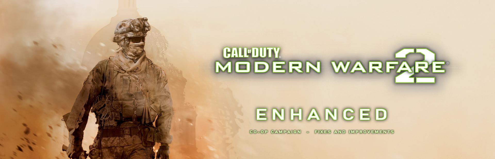

<p align="center"><a href="README.md">English</a> · <b>Русский</b></p>

<p align="center">
  
</p>

<p align="center">
  <a href="https://github.com/stxlvn/mw2_enhanced/releases/latest"></a>
  <a href="https://www.nexusmods.com/codmw2/mods/99"></a>
  
  
  
  <a href="LICENSE"></a>
</p>

<h3 align="center">Modern Warfare 2 (2009) — лучше. Пройдите всю кампанию вдвоём с другом.</h3>

<p align="center">
  <b>Modern Warfare 2 Enhanced</b> — мод для оригинальной игры 2009 года на актуальной <b>64-битной Steam-версии</b>, по духу как <a href="https://github.com/alicealys/h2-mod">h2-mod</a>. Начинаем с того, чего игре не хватает больше всего: <b>кооператива на двоих на всю кампанию</b>, по сети или на одном ПК с <b>разделённым экраном</b> (новое, экспериментально), на сетевом коде, который уже есть в игре для Спецопераций (Spec Ops). Исправления и улучшения самой игры добавляются по мере находок.<br>
  <a href="https://github.com/stxlvn/mw2_enhanced/releases/latest"><b>⬇ Скачать последний релиз</b></a> · <a href="https://www.nexusmods.com/codmw2/mods/99">Nexus Mods</a> · <a href="#install">Установка</a> · <a href="#known-issues">Известные проблемы</a>
</p>

<p align="center">
  <a href="https://discord.gg/uCvu82XHX"></a>
</p>

---

## ✨ Возможности

### 🤝 Кооператив в кампании

- 🤝 **Настоящая кампания на двоих.** Оба ПК идут по уровню синхронно, поэтому мир, враги и все скриптовые сцены общие, а не изображаются.
- 🎬 **Все сцены кампании переделаны на двоих**: транспорт, пулемёты, подъёмы, заплывы, кат-сцены и финальный бой на ножах. Никто не остаётся позади и не выпадает из сцены.
- 🎯 **Враги воюют с обоими**, а сцены, которые защищают игрока, защищают обоих.
- 🩹 **Ранения и подъём** по системе самой игры; ранены оба — перезапуск вместе.
- 🎚 **Одна сложность на двоих**: та, что хост выбрал в лобби.
- 🔫 **Переключатель огня по своим**: хост в лобби включает или выключает урон между игроками (по умолчанию включён).
- 🚩 **Чекпоинты во всех миссиях**: проваленная миссия начинается заново с последнего участка, до которого вы оба дошли.
- 🧭 **Создание игры и вход из меню игры**: Кампания → кооперативное лобби, выбор миссии, доступ открытый / только друзья в Steam / пароль, список игр в сети, вход по адресу или по приглашению Steam.
- 🌐 **Просто играть через интернет**: игра сама предлагает разрешение в брандмауэре Windows и открывает порт на роутере через UPnP.
- 🖥 **Разделённый экран на одном ПК (новое, экспериментально)**: Кампания → РАЗДЕЛЕНИЕ ЭКРАНА — оба игрока в одном окне игры, картинка разрезана сверху и снизу, как в версии для Xbox 360, у каждой половины свой вид, оружие, интерфейс и эффекты. Каждый выбирает устройство в лобби, нажимая на нём кнопку (клавиатура и мышь или геймпад); у геймпада раскладка консоли, помощь в прицеливании, вибрация, его кнопки в подсказках и своя страница настроек. Над игроками написано Alpha и Bravo.
- 🎞 **Загрузка как в одиночной игре**: экран загрузки кампании с брифингом миссии; по сети уровень ждёт, пока ролик не кончится или кто-то из игроков его не пропустит.
- 💾 **Сохранения для каждого прохождения у хоста**: сохранение помнит, кто в нём играл. «Продолжить» берёт прохождение вашего напарника, «Выбрать сохранение» показывает список (миссия и игроки); если играете дальше с новым игроком, игра сначала спросит: добавить его в участники прохождения или начать новую игру с начала. На следующую миссию переходите вместе, а рекорды кампании (открытые миссии, сложность, достижения) пишутся каждому в его профиль, как в одиночной игре.
### 🛠 Исправления и улучшения игры

- 🔤 **Шрифты ближе к английскому оригиналу (русская игра)**: русская сборка рисует весь текст одним обычным гротеском; мод подставляет шрифты H\*-Mod (сделал Влад Локтионов для h2-mod): как Bank Gothic для заголовков, как Conduit для обычного текста, жирный для текста заставок миссий (SIL OFL; `mw2coop\fonts`). Выключается `fonts=0` в `settings.ini`; английскую игру мод не трогает.
- 📝 **Исправления русского текста**: цель в «Побеге из фавел» больше не называет капитана Прайса до того, как он появился в сюжете (формулировка из перевода h2-mod). Другие правки приветствуются в задачах (issues).
- ⌨️ **Консоль разработчика**: клавиша слева от 1 (~) открывает консоль MW2 Enhanced в любой сборке (в оригинальной игре её нет). Есть раскладки Enhanced и Legacy; Legacy по умолчанию занимает половину ширины игрового окна с отступом 16 px от верхней и левой границ игрового окна. Окно можно перемещать и менять по размеру с левого, правого и нижнего краёв; в нижних углах работают диагональные направления изменения размера. Свёрнутый заголовок тоже можно перетаскивать; перетаскивание также доступно за пустые участки output и строки состояния. Одиночный щелчок обрабатывается через 220 мс, чтобы отличать его от двойного щелчка. Слева от редактируемого поля ввода находится запоминаемая кнопка «Режим паузы» (по умолчанию выключена и серая); в заголовке остаются местное время с секундами в формате 12/24 часа согласно региональным настройкам Windows и кнопки сворачивания, разворачивания и закрытия. Когда Pause mode приостанавливает игру, которая до открытия окна работала, под содержимым консоли появляется большая приглушённая надпись `|| Игра приостановлена`; если игра уже была на паузе до открытия, надпись не показывается. При включённом режиме открытие консоли отправляет `cl_paused 1`, а закрытие — `cl_paused 0`, только если игра не была на паузе ещё до открытия. Режим паузы захватывает мышиный ввод на время работы консоли, поэтому перемещение указателя по её области не двигает курсор внутриигровых меню. Есть поиск команд и dvar, дополнение по Tab с текущими и стандартными значениями, а также поиск dvar по текущему значению через `*=%значение%` (в том числе по векторам со значениями через пробел), история команд, выделение слова двойным щелчком, копирование текста, полосы прокрутки вывода и подсказок, а также многострочный ввод, который растёт вверх, не меняя внешние размеры окна. В раскладке Enhanced автозаполнение остаётся внутри окна; в Legacy панель предложений предпочитает размещение снизу с прокруткой и использует боковой popup только когда ни одно вертикальное размещение не вмещает даже одну строку подсказки. Если пользователь прокручивает output назад и отправляет команду, новые строки показываются во всплывающем уведомлении под правым нижним углом консоли, а исторический output остаётся единой областью прокрутки. Консоль больше не телепортирует физический курсор: в режиме относительного/захваченного ввода рисуется программный указатель по данным Raw Input, а в обычном режиме меню используется системный курсор Windows. Raw Input перехватывается, когда приходит на окно игры или на безопасно подключённое окно того же процесса; регистрации другого процесса не перенаправляются. Курсор перемещения появляется над заголовком только во время удержания левой кнопки и активного перетаскивания; на краях изменения размера используются соответствующие курсоры, а над кликабельными подсказками — рука. Интерфейс пропорционально масштабируется по DPI окна игры. Эхо команд в output начинается с `]`, поле ввода — с жёлтого `> `. Значение dvar `version` показывается без подписи в приглушённой нижней строке состояния развёрнутого окна, отдельно от output. Фон подсказок автозаполнения немного темнее основного фона консоли, а фон всплывающих подсказок кнопок непрозрачный. Пиктограммы заголовка, угла ресайза и свёрнутого окна рисуются со сглаживанием; текст использует grayscale-сглаживание GDI без цветных ореолов ClearType на прозрачном слое. Если окно узкое, значение в строке состояния сокращается многоточием. Количество команд склоняется по правилам русского и английского языков (`1 команда`, `5 команд`, `23 команды`; `1 command`, `5 commands`). Доступны `cmdlist`, `dvarlist`, `dvardump`, `find` и `condump`. Дополнительные инструменты: поиск по output (`Ctrl+F`, `F3`, `Shift+F3`), история команд с фильтром по введённому префиксу, закрепление dvar кнопкой-булавкой справа от каждой подсказки автодополнения без фиксированного лимита по количеству: в новом профиле и при первом обновлении автоматически добавляются `mapname` и `viewposNow`, избранные dvar занимают отдельные строки под настоящей строкой состояния, до четырёх элементов в каждой; неполная строка растягивает элементы на всю доступную ширину, чтобы значения реже обрезались; значения обновляются автоматически, включая числовые векторы FLOAT2/FLOAT3/FLOAT4 и цветовые векторы (видимая часть списка зависит от доступной высоты окна). У отдельных элементов нет рамок и кликабельной области: при наведении на избранный dvar справа появляется небольшая иконка открепления, нажимать нужно только её; на самом тексте остаётся обычный курсор. Правая кнопка мыши для удаления не требуется. (Команды `watch`, `unwatch`, `watchlist` также доступны для управления списком.) Есть и `dvarcompare <имя>` для сравнения текущего, исходного и отложенного значений. Тройной щелчок выделяет строку output целиком; в контекстном меню есть `Copy Line`. По нажатию на уведомление о новых строках можно перейти к последнему output, а крестик закрывает уведомление без изменения исторической позиции прокрутки. Раскладка, положение и размер окна, язык интерфейса, режим паузы, закреплённые dvar сохраняются в `mw2coop\settings.ini` (`[console] pause_mode=0|1`; по умолчанию `0`).
- 🖼 **Полноэкранный режим в окне по умолчанию (`borderless=1`)**: эксклюзивный полный экран игры заменяется окном без рамки на весь экран, поэтому Alt+Tab больше не теряет графическое устройство (раньше он замораживал напарника в кооперативе, потом ронял игру, а в разделённом экране ещё и при возврате). `borderless=0` возвращает родной полный экран игры.
- 🔭 **Апскейлеры (экспериментально, по умолчанию выключены; FSR 3 и DLSS только в 64-бит)**: игра рисует в разрешении ниже размера окна, а картинка увеличивается: AMD **FSR 1** (`upscale=1`), AMD **FSR 3** (`fsr3=1`; векторы движения восстанавливаются по глубине игры, DLL от AMD не входят в комплект, см. `settings.ini`) и NVIDIA **DLSS** (`dlss=1`, GeForce RTX; её мост-DLL собирается отдельно от этого репозитория из-за лицензии NVIDIA, см. [`src/dlss/README.md`](src/dlss/README.md)). FSR 3 и DLSS работают на **Direct3D 9 on 12** (`d3d9on12=1`, Direct3D 9 игры поверх Direct3D 12), который можно включить и отдельно. Замер на ноутбуке с RTX 3060: FPS при 1080p они не добавляют, потому что здесь игра упирается в процессор (видеокарта занята примерно на треть); они нужны для качества картинки и для случаев, когда упирается видеокарта.
- 🎛 **Параметры сессии в `[gameplay]`** (урон от падения, высота прыжка, гравитация; значения хоста передаются второму игроку) и **сетевая защита** (`guard=1`, включена по умолчанию), которая отбрасывает пакеты, которых не шлёт ни одна кооперативная сессия.
- 🧩 **Ничего из игры не заменяется**: один `winmm.dll` и папка `mw2coop`; скрипты правятся в памяти при загрузке.

## 🎮 Миссии

| Миссия | Что переделано на двоих |
|---|---|
| Д.Д.Б.Т. (S.S.D.D.) | оба начинают в мешках на стрельбище; каждый берёт свою винтовку, пистолет и гранаты; ворота полосы закрываются, когда прошли оба, спринт любого засчитывается |
| Командный игрок (Team Player) | вступление Шепарда для обоих; кто первым сел на светящееся место — стрелок, второй едет рядом (без смены мест); конец поездки и авария для обоих; сменить места может любой, на поездке урона между вами нет |
| Скалолаз (Cliffhanger) | подъём по льду бок о бок, у каждого свои ледорубы, большой прыжок (Соуп ловит каждого), у каждого свой снегоход, вертолёт ждёт обоих; у обоих стелс-видимость, напарник видит ваш снегоход целиком и вас в седле, а на стене — ваше тело, лезущее вверх (ледорубы стоят прямо в руках) |
| Ни слова по-русски (No Russian) | оба в облике бойцов Макарова; своё место в лифте; прикрытие и линия огня считаются для любого игрока; в концовке стреляют в обоих |
| Захват (Takedown) | оба едут в машине в начале; каждый пригибается своей клавишей |
| Росомахи! (Wolverines!) | второй игрок едет в «Хаммерах» в начале и в конце |
| Осиное гнездо, Исход (The Hornet's Nest, Exodus) | оба начинают вместе; лазерный целеуказатель в «Исходе» достаётся случайному из двух |
| Как в старые времена (Just Like Old Times) | спуск в начале миссии: кто первым зацепился, тот спускается и убивает охранника внизу, второй спускается следом |
| Лёгкий день был только вчера (The Only Easy Day...) | у каждого свой подводный буксировщик, всплывают оба; бесшумное убийство делает тот, кто ударил первым; вертолёт при побеге берёт обоих, рядом на скамье; в разделённом экране оба экрана следуют за сменой цветов уровня (игрок 2 раньше оставался подводно-синим) |
| ГУЛАГ (The Gulag) | оба прилетают у двери вертолёта; верёвка в блоке камер (оба спускаются по очереди) и эвакуация по тросу к Pavelow (каждый цепляется сам) |
| Побег из фавел (Escape from Favela) | большой прыжок через пролёт (прыгают оба, Соуп тянется к обоим) и верёвочная лестница вертолёта: кто первым прыгнул, тот начинает сцену, второй хватается за ту же верёвку |
| По собственной воле / Второе солнце (Of Their Own Accord / Second Sun) | полёт на «Чёрном ястребе» для обоих, оба приходят в себя после крушения, рядом на МКС, падающий вертолёт гонится за каждым |
| Белый дом (Whiskey Hotel) | сигнальная ракета у каждого на крыше |
| Враг моего врага (The Enemy of My Enemy) | второй игрок едет на заднем сиденье УАЗа прямо в C-130 |
| Незаконченные дела (Loose Ends) | предательство Шепарда для обоих: вы проходите концовку как Роуч, его выстрел попадает в обоих |
| Эндшпиль (Endgame) | один ведёт лодку, другой стреляет с носа; бой с Шепардом на ножах играет тот, кто ударил первым, второй смотрит |

Заставка с названием миссии держит обоих игроков и показывается только при первом запуске миссии.

## 🧭 Планы

Modern Warfare 2 Enhanced растёт в мод-улучшение оригинальной игры, а не только кооператива: исправления перевода и шрифтов, исправления отрисовки (например, чёткость уменьшенного текста), удобство. Сроков нет; что уже сделано — в [списке изменений](CHANGELOG.ru.md), идеи и ошибки — в [Issues](https://github.com/stxlvn/mw2_enhanced/issues).

<a id="install"></a>
## 📦 Установка

> Обоим нужна **Call of Duty: Modern Warfare 2 (2009) в Steam**, актуальная **64-битная версия**, и **одна и та же версия мода**.

1. Скачайте `mw2coop-<версия>.zip` из [релизов](https://github.com/stxlvn/mw2_enhanced/releases/latest). (Для старой **32-битной** игры рядом лежит `mw2coop-<версия>-x86.zip`, для клиента **iw4x-sp** — экспериментальный `mw2coop-<версия>-iw4x.zip`; что в них проверено, написано в их `INSTALL.txt`.)
2. Steam → Библиотека → Modern Warfare 2 → ⚙ Управление → **Просмотреть локальные файлы** (папка с `iw4sp.exe`).
3. Скопируйте туда `winmm.dll` и папку `mw2coop`. Файлы игры не заменяются.
4. **Хост:** Кампания → СЕТЕВАЯ ИГРА ВДВОЕМ. Миссия и доступ выбираются в лобби.
5. **Напарник:** примите приглашение хоста в Steam или Кампания → ПРИСОЕДИНИТЬСЯ К ИГРЕ, затем выберите игру в списке или введите адрес хоста.
6. Оба нажимают **Готов**, хост — **Начать**.

> **Ночные сборки:** с каждым новым коммитом в `main` тестовая сборка (архивы для 64-битной и 32-битной игры и для клиента iw4x-sp) публикуется как пре-релиз [nightly](https://github.com/stxlvn/mw2_enhanced/releases/tag/nightly) и заменяет предыдущую. Она только собрана, но не пройдена игрой: сохраните свою папку `mw2coop` и `winmm.dll` и ждите ошибок.

**Разделённый экран на одном ПК:** Кампания → РАЗДЕЛЕНИЕ ЭКРАНА. Каждый игрок нажимает кнопку на том устройстве, на котором будет играть (карточки Альфа и Браво это покажут), затем «Старт». Раскладка геймпада и настройки описаны в `INSTALL.txt`.

То же самое на русском и английском есть в `INSTALL.txt` внутри архива. Чтобы удалить мод, удалите `winmm.dll` и папку `mw2coop`.

## 🌐 Игра через интернет

У хоста должен быть доступен UDP-порт **28960**. Если на роутере включён UPnP, мод откроет порт сам; иначе пробросьте порт вручную или играйте через общий VPN. Порт меняется в `mw2coop\settings.ini` (у обоих одинаковый).

Что-то не так? Пришлите `mw2coop\mw2coop.log` с обоих ПК.

<a id="known-issues"></a>
## ⚠️ Известные проблемы

- Замедление времени идёт на обоих экранах, кто бы его ни вызвал: у обоих ПК одно игровое время, показать его только одному игроку нельзя.
- Чекпоинты: боты проваливают миссию в каждой секции каждой миссии кампании, в 64- и 32-битной версиях, и проверяют, что уровень начинается заново с обоими игроками живыми и рядом (всё проходит). Перезапуск идёт на собственный чекпоинт уровня, иногда это секция перед той, где вы погибли. Вдвоём людьми пока не пробовали.
- Редко (один раз примерно на сто загрузок миссий, замечено в 32-битной версии) оба ПК зависают сразу после старта миссии. Причина найдена и исправлена (см. список изменений), но одно зависание ничего не доказывает; если случится, перезапустите миссию и сообщите нам.
- Разделённый экран, «Ни слова по-русски» (аэропорт): после лифта камера второго игрока может остаться там, где он был (в лифте, у стены или в клумбах у эскалатора), пока его тело стоит в другом месте; нижняя половина тогда показывает не то место. Известно, разбираемся.
- Разделённый экран: окружающие персонажи (отряд, гражданские) в картинке обеих половин могут дёргаться. Известно, разбираемся.
- Всю кампанию вдвоём от начала до конца пока никто не прошёл — расскажите, докуда дошли вы.
- Разделённый экран, смена уровня: причина падений при смене уровня в одной сессии найдена и исправлена 2026-11-09 (половина игрока 2 хранила состояние прошлого уровня, см. журнал изменений); после этого цепочка из четырёх миссий подряд прошла в 32-битной игре, а вторая неисправность загрузки уровня (`iw4sp.exe+0xfb41b`, отсутствующая запись таблицы имён) теперь прикрыта защитой (см. журнал изменений). Одна более длинная 32-битная цепочка всё же упала внутри драйвера NVIDIA (`nvd3dum.dll`); не разобрано.
- «Скалолаз», большой прыжок, разделённый экран: в тесте ботов (`mw2coop_qa climb`) первый игрок цепляется после прыжка, а второй падает мимо скалы и проваливает миссию сообщением «держись крепче» (5 прогонов из 8; в журналах неудачных прогонов игрок 2 так и не делает прыжок: он привязан и падает с уступа до него, подозрение на управление бота на разбеге); у настоящей пары падения не видели; не разобрано и не сравнивалось со старой сборкой (v0.6.0 падает раньше, на выдаче ледорубов).
- Разделённый экран (новое): проверен ботами, кадрами обеих половин и имитацией геймпадов, но ещё не на двух настоящих геймпадах и не живыми людьми. Звук один на двоих (слышно с места первого игрока), второй клавиатуры нет, второй игрок может только ставить паузу (не управляет меню); игра может не закрыться сама после выхода (закройте её в диспетчере задач).
- Геймпады: разделённый экран и выбор устройства в лобби читают XInput-геймпады (Xbox и совместимые). Геймпаду PlayStation или другому нужна обёртка, которая делает его XInput-геймпадом (Steam Input, DS4Windows). С двумя разными геймпадами под Steam Input в похожем проекте (MW2 Recompiled, его issue 5) помогло отключить Steam Input для одного из них; здесь не пробовали. Если геймпад не вибрирует, проверьте, что «Вибрация» включена в настройках управления самой игры (в issue 8 того проекта дело было в этом). Собственной поддержки геймпадов PlayStation нет.
- Разделённый экран 32-битной игры (архив `-x86`) проверен ботами только на тренировке и в «Скалолазе». Клиент iw4x-sp (архив `-iw4x`) экспериментальный: проверен ботами только на тренировке.
- Апскейлеры (экспериментально): на проверенном ноутбуке FSR 3 и DLSS не дали прироста FPS при 1080p (см. выше); DLSS пока не проверен на шлейф при поворотах. В песчаной буре «Командной игры» FSR 3 увеличивает кадр в самом конце, поэтому HUD там такой же мягкий, как картинка. В 32-битных сборках и в iw4x-sp есть только FSR 1.
- Падение при включённых оверлеях Steam и Discord после того, как игра заново создала графическое устройство (`vid_restart`, смена настроек видео, в тесте ещё и запуск уровня в 32-битной игре): оба оверлея перехватывают одни и те же вызовы Direct3D 9 и вызывают друг друга, пока не переполнится стек (`mw2coop.log`: `CRASH: exception 0xc00000fd`, повторяются кадры `GameOverlayRenderer.dll` и `DiscordHook.dll`). По журналу, это не код самого мода; помогает отключить один из двух оверлеев.
- «Лёгкий день был только вчера»: сообщение о том, что штурм с заложниками проваливается сам, даже когда все враги убиты, пока не найдено (выстрелы по охране внутри до взрыва двери проваливают миссию по замыслу игры); если случится, пришлите `mw2coop\mw2coop.log` и скажите, в какой комнате. Тестировщик повторить это не смог: в его логе миссия дважды провалилась штатным сообщением игры «враги подняли тревогу, заложники убиты».
- Новейшие сцены (спуски по верёвке и лестница, вид снегохода и подъёма в «Скалолазе») проверены ботами только на двух копиях: живыми людьми их ещё не проходили, так что присмотритесь к ним и сообщите, что выглядит не так.

## 🧪 Как проверяется

Две копии игры на одном ПК (хост и клиент), которыми управляют боты внутри игры: каждый сценарий проверки идёт на обеих машинах и пишет PASS или FAIL. Где это важно, боты нажимают настоящие кнопки через привязки клавиш игры, а обход уровня посещает каждую стартовую точку и снимает кадры с обоих экранов. Разделённый экран проверяется кадрами обеих половин, которые собирает мод, и сценариями с имитацией геймпадов. Каждое исправление идёт с тестом, который до него падал, а после проходит. На GitHub каждый pull request запускает проверку файлов патчей, скриптов и содержимого репозитория и собирает три архива, а каждый push в `main` собирает ночные архивы; применяются ли патчи к скриптам самой игры, проверяется на ПК разработчика (файлов игры в репозитории нет).

---

<details>
<summary>🛠 <b>Разработчикам: как это устроено</b></summary>

- `winmm.dll` — прокси: все 180 экспортов `winmm` уходят в системную DLL. `iw4sp.exe` импортирует `winmm.dll`, поэтому Windows загружает прокси из папки игры. На чужой сборке игры мод не включается.
- Адреса получены реверсом 64-битной сборки (Ghidra) и перечислены с описанием в `src/game.h`, `src/scripts.c`, `src/scrdebug.c`.
- `Scr_AddSourceBuffer` заменена: `mw2coop\scripts\<файл>` добавляет или заменяет скрипт, `mw2coop\patches\<файл>.patch` правит текст скрипта игры при загрузке. Мод никогда не распространяет скрипты игры целиком. Формат патчей — в `src/scripts.c`. Если функцию уже перехватил другой мод, mw2coop встраивается за ним в цепочку.
- `content/scripts/maps/_mw2coop.gsc` — основа кооперативной кампании: режим кампании в кооп-сессии, второй игрок рядом с первым, синхронизация оружия, чекпоинты как стартовые точки уровня, перезапуск, когда ранены оба, конец миссии. Скрипты просят DLL хоста о действиях (перезапуск, сохранение прогресса) через переменную `mw2coop_cmd`.
- Сохранения: каждый ПК писал бы и загружал своё сохранение и терял бы синхронность, поэтому автосохранения выключены; прогресс — это стартовая точка уровня (переменная `start`) и сохранение у хоста, `mw2coop\progress\save_<n>.txt` (миссия, стартовая точка, участники: id каждого напарника из его `mw2coop\player.ini`, Steam ID и имя; см. `src/progress.c`).
- В кооп-сессии GSC `getdvar` возвращает только переменные с определёнными флагами; DLL выставляет флаги `start`, переменным QA и всем переменным, которые уровень задаёт сам, чтобы уровни, читающие свои переменные, работали как в одиночной игре.
- Сложность: окно выбора в лобби только «откладывает» `g_gameskill`; DLL перехватывает `profile_difficultySave`, берёт выбор хоста и отправляет его клиенту вместе с `coopLaunch`.
- Диагностика в `mw2coop\mw2coop.log`: ошибки GSC со стеком вызовов скриптов (повторы пишутся на 1, 2, 3, 10, 100, 1000... разе), падения с адресом и стеком, `!trace <rva>` пишет каждый вызов встроенного метода.
- Разделённый экран: один процесс игры ведёт двух локальных игроков. DLL держит вторую копию состояния клиента (вид, интерфейс, система эффектов, ввод) и подставляет её на каждый кадр для половины второго игрока, затем собирает обе половины в окне (`src/native.c`, `docs/native-splitscreen-plan.md`). Лобби выбирает устройство каждого игрока по первой нажатой на нём кнопке.
- 32-битная версия мода (`sh build.sh x86`, `docs/32bit-plan.md`) и её профиль для iw4x-sp (`sh build.sh x86 iw4x`; адреса iw4x-sp 1.0.159 сопоставлены в `src/addr159.c`, его создаёт `tools/gen_addr159.py`) выходят отдельными архивами `mw2coop-<версия>-x86.zip` и `mw2coop-<версия>-iw4x.zip` (экспериментальный) в каждом релизе.

</details>

<details>
<summary>⌨ <b>Создание игры и вход вручную (консоль)</b></summary>

Для тестов эти строки кладутся в `mw2coop\commands.txt`, мод выполняет их по порядку (дописанные строки — по мере появления; `!sleep <мс>` ждёт). Сначала игра должна показать подключение к сети (около 10 с после запуска).

Хост:
```
set coop_mapName trainer
listen
coopLaunch
```
`coopLaunch` можно дать заранее: игра начнёт миссию, когда напарник подключится. Чтобы продолжить с того же места, замените `set coop_mapName ...` на `mw2coop_continue`. Хост сам отправляет клиенту стартовую точку вместе с `coopLaunch`. Чтобы выбрать чекпоинт вручную, перед `coopLaunch` задайте `set start <стартовая точка>`; `set mw2coop_god 1` включает тестовое бессмертие (клиент берёт его у хоста).

Клиент (`8305` — это порт 28960 с переставленными байтами, так его ждёт `connect` игры):
```
mw2coop_party_join
connect <IP хоста> 8305
```
`mw2coop_party_join` заменяет шаг Steam-лобби из обычного приглашения.

</details>

<details>
<summary>🔧 <b>Сборка</b></summary>

Нужны [llvm-mingw](https://github.com/mstorsjo/llvm-mingw) и POSIX-оболочка (Git Bash):
```
LLVM_MINGW=/путь/к/llvm-mingw-ucrt-x86_64 ./build.sh release
```
`tools/make_release.sh <версия> [x86|iw4x]` собирает релизную DLL (с проверкой, что в ней нет локальных путей) и пакует `dist/mw2coop-<версия>.zip` со скриптами, патчами и `content/release` (`INSTALL.txt`, `settings.ini`, помощник для брандмауэра), плюс его SHA-256; `x86` и `iw4x` пакуют `mw2coop-<версия>-x86.zip` (старая 32-битная игра) и `mw2coop-<версия>-iw4x.zip` (клиент iw4x-sp). `tools/gen_winmm_proxy.py` пересоздаёт заглушки экспорта из системной `winmm.dll`.

Тестерам: используйте **копию** папки игры, а не установку Steam, и запускайте её с переменными `SteamAppId=10180` и `SteamGameId=10180` (без них обёртка DRM Steam закрывается, и Steam запускает вашу **настоящую** установку); `tools/run_test.ps1` делает это и закрывает любой `iw4sp.exe` вне тестовой папки.

</details>

<details>
<summary>🧪 <b>Тесты</b></summary>

`tools/qa_pair.sh <сценарий> [стартовая точка] [секунды] [карта]` запускает на одном ПК копии хоста и клиента, соединяет их, прогоняет на обеих сценарий проверки (`content/scripts/maps/_mw2coop_qa.gsc`; подъём в «Скалолазе» — в `_mw2coop_climb_qa.gsc`), выводит оба лога и закрывает копии, когда сценарий закончен. Достаточно одного аккаунта Steam: команда только для QA `!xuid_add` даёт второй копии другой идентификатор игрока. `MW2COOP_GOD` задаёт тестовое бессмертие (в QA включено по умолчанию), `MW2COOP_HOST_CMDS` выполняет строки только на хосте перед `coopLaunch`.

Сценарии:
- **Любая карта:** `spawn`, `leash`, `look` (игроки смотрят друг на друга для кадров), `targets` (с кем воюют враги), `buttons` (настоящие «Вперёд» и «Использовать» на машине каждого игрока), `introfreeze`, `tour` (все стартовые точки уровня, ходьба настоящими нажатиями, триггеры, кадры с обоих экранов).
- **Ранения и сложность:** `god`, `downs` («Новобранец»), `sceneskill` (угроза и меткость сцены переживают ранение и подъём), `skill` (выбор хоста на обеих машинах).
- **Д.Д.Б.Т.:** `intro`, `restart`, `end`, `resume` (`@continue`), `pickups`, `bay`.
- **Командный игрок:** `rkintro`, `board`, `rideend`, `turret`. **Росомахи!:** `ride`. **Захват:** `takedown`, `takedown2`.
- **Лёгкий день:** `oilrig`, `oilrig2`. **Скалолаз:** `climb`, `snow`, `snowpick`.
- **Ни слова по-русски:** `nrend`, `nrend2`, `cover`, `lineoffire`, `bodyview`. **Место крушения / Второе солнце:** `crashsite`, `dcemp`, `street`.
- **Белый дом:** `flares`. **Незаконченные дела:** `betrayal`. **Эндшпиль:** `boat`, `boat2`, `knife`, `knife2`.

Сценарий может нажимать кнопки игрока по-настоящему: `press( player, "activate", ms )` заставляет машину этого игрока выполнить привязку клавиши (`mw2coop_bind +activate`, см. `src/control.c`). Настоящие нажатия используются в `buttons`, `pickups`, `introfreeze`, `bay`, `look`, `flares` и при ходьбе в обходе уровня; старые сценарии сцен двигают игроков скриптом (удержание кнопок, толчки скоростью) и настоящим вводом не проверялись. Разделённый экран: `tools/qa_native.sh [секунды] [доп. строки [native]]` запускает одну копию с обоими игроками и сохраняет собранный кадр; `MW2COOP_LOBBY=1` проходит меню и лобби с имитацией геймпадов (`MW2COOP_PAD`), остальные параметры — в начале скрипта. `tools/check_patches.py` сверяет патчи с извлечёнными скриптами игры без запуска игры; `tools/gen_*_patches.py` генерируют крупные патчи из извлечённых скриптов.

</details>

## 🙏 Благодарности

Код Modern Warfare 2 Enhanced (внутри он называется `mw2coop`: так же называются папка, скрипты и настройки) наш собственный, но он опирается на чужую работу:

- **[h2-mod](https://github.com/alicealys/h2-mod)** (alicealys и участники): образец для этого мода и источник русской формулировки цели в «Побеге из фавел».
- **COD-MOD** и его пак кооперативной кампании (`x_coop`, автор неизвестен): первый кооп кампании MW2, для старой 32-битной версии. Перед каждой миссией мы смотрели, как это сделано там (где стоят игроки, сигнальная ракета в «Белом доме»), и потом делали своё. Клиент COD-MOD — momo5502 и соавторы ([FreeTheTech101/cod-mod](https://github.com/FreeTheTech101/cod-mod)).
- **[iw4x-sp](https://git.alterware.dev/alterware/iw4x-sp)** от AlterWare: по нему разбирались, как движок обрабатывает ввод игрока и пулы ресурсов (только для справки, код не брали).
- **Infinity Ward**: кооператив Спецопераций самой игры, из которого мод делает режим кампании.
- **[Co-op Anything](https://github.com/cranebeaker/coop-anything)**: методички и инструменты тестирования, с которыми сделан мод.
- Инструменты: [Ghidra](https://github.com/NationalSecurityAgency/ghidra) (NSA), [llvm-mingw](https://github.com/mstorsjo/llvm-mingw) (Martin Storsjö), [Capstone](https://www.capstone-engine.org/), [документация Steamworks](https://partner.steamgames.com/doc/home), значки [shields.io](https://shields.io).

## ⚖️ Правовое

Не связано с Activision и Infinity Ward и не одобрено ими. Call of Duty и Modern Warfare — товарные знаки Activision; баннер — фанатская работа на основе арта и логотипа игры из Steam. Нужна своя копия игры; файлы игры не включены. Собственный код мода распространяется по лицензии MIT (см. `LICENSE`). Файлы патчей цитируют короткие строки скриптов игры только чтобы указать, куда вносится изменение; эти строки принадлежат их владельцам и лицензией MIT не покрываются. Мод использует кооперативный режим игры между игроками, которые договорились играть вместе; он не предназначен для читерства в мультиплеере.
