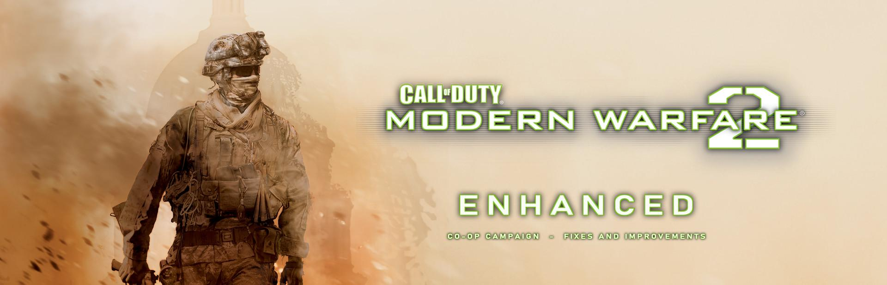

<p align="center"><a href="README.md">English</a> · <b>Русский</b></p>

<p align="center">
  
</p>

<p align="center">
  <a href="https://github.com/stxlvn/mw2_enhanced/releases/latest"></a>
  <a href="https://www.nexusmods.com/codmw2/mods/99"></a>
  
  
  
  <a href="LICENSE"></a>
</p>

<h3 align="center">Modern Warfare 2 (2009) — лучше. Пройдите всю кампанию вдвоём с другом.</h3>

<p align="center">
  <b>Modern Warfare 2 Enhanced</b> — мод для оригинальной игры 2009 года на актуальной <b>64-битной Steam-версии</b>, по духу как <a href="https://github.com/alicealys/h2-mod">h2-mod</a>. Начинаем с того, чего игре не хватает больше всего: <b>кооператива на двоих на всю кампанию</b>, по сети или на одном ПК с <b>разделённым экраном</b> (новое, экспериментально), на сетевом коде, который уже есть в игре для Спецопераций (Spec Ops). Исправления и улучшения самой игры добавляются по мере находок.<br>
  <a href="https://github.com/stxlvn/mw2_enhanced/releases/latest"><b>⬇ Скачать последний релиз</b></a> · <a href="https://www.nexusmods.com/codmw2/mods/99">Nexus Mods</a> · <a href="#install">Установка</a> · <a href="#known-issues">Известные проблемы</a>
</p>

<p align="center">
  <a href="https://discord.gg/uCvu82XHX"></a>
</p>

---

## ✨ Возможности

### 🤝 Кооператив в кампании

- 🤝 **Настоящая кампания на двоих.** Оба ПК идут по уровню синхронно, поэтому мир, враги и все скриптовые сцены общие, а не изображаются.
- 🎬 **Все сцены кампании переделаны на двоих**: транспорт, пулемёты, подъёмы, заплывы, кат-сцены и финальный бой на ножах. Никто не остаётся позади и не выпадает из сцены.
- 🎯 **Враги воюют с обоими**, а сцены, которые защищают игрока, защищают обоих.
- 📍 **Метки для напарника (новое)**: короткое нажатие Z (на геймпаде Back) отмечает для обоих то, на что вы смотрите: врага (красная метка над ним следует за ним), вражескую технику или пулемётчика, гранату или мину, бочку или машину, которая взорвётся, оружие на земле (с названием) или патроны, либо место; два быстрых нажатия — «опасность», повторное нажатие на свою метку убирает её. Удержание Z открывает колесо: враг, атакую, иду сюда, жди здесь, опасность, отступаем, смотрю сюда, прикрываю; наведите мышь (на геймпаде правый стик) и отпустите, прицел в это время стоит на месте. Строка на экране говорит, кто что отметил. Клавиша задаётся в `settings.ini` (`[input] ping_key`) или командой `bind <клавиша> +mw2coop_ping` в консоли.
- 🩹 **Ранения и подъём** по системе самой игры; ранены оба — перезапуск вместе.
- 🎚 **Сложность**: по сети — та, что хост выбрал в лобби, для обоих; в разделённом экране каждый выбирает свою (строки Alpha и Bravo, как две кнопки сложности в консольной игре).
- 🔫 **Переключатель огня по своим**: хост в лобби включает или выключает урон между игроками (по умолчанию включён).
- 🚩 **Контрольные точки самой игры**: проваленная миссия возвращается к последней контрольной точке, как в одиночной игре, а уровень, враги, задачи и оружие обоих игроков — такими, какими были (64-битная игра и клиент iw4x-sp; старая 32-битная игра вместо этого начинает заново с участка уровня).
- 🧭 **Создание игры и вход из меню игры**: Кампания → кооперативное лобби, выбор миссии, доступ открытый / только друзья в Steam / пароль, список игр в сети, вход по адресу или по приглашению Steam.
- 🌐 **Просто играть через интернет**: игра сама предлагает разрешение в брандмауэре Windows и открывает порт на роутере через UPnP.
- 🖥 **Разделённый экран на одном ПК (новое, экспериментально)**: Кампания → РАЗДЕЛЕНИЕ ЭКРАНА — оба игрока в одном окне игры, картинка разрезана сверху и снизу, как в версии для Xbox 360, у каждой половины свой вид, оружие, интерфейс и эффекты. Каждый выбирает устройство в лобби, нажимая на нём кнопку (клавиатура и мышь или геймпад); у геймпада раскладка консоли, помощь в прицеливании, вибрация, его кнопки в подсказках и своя страница настроек. Над игроками написано Alpha и Bravo. Каждый игрок рисуется в своём кадре рендерера, как на консоли; Спецоперации тоже идут в разделённом экране, с интерфейсом консольной игры для разделённого экрана, а Настройки → Enhanced → «Игроки по разным углам (как на консолях)» даёт консольную раскладку из двух смещённых окон.
- 🎞 **Загрузка как в одиночной игре**: экран загрузки кампании с брифингом миссии; по сети уровень ждёт, пока ролик не кончится или кто-то из игроков его не пропустит.
- 💾 **Сохранения для каждого прохождения у хоста**: сохранение помнит, кто в нём играл. «Продолжить» продолжает с последней контрольной точки игры на обоих ПК, с тем напарником, с которым прохождение играли (64-битная игра и клиент iw4x-sp); «Выбрать сохранение» показывает список прохождений (миссия и игроки); остальным предлагается новая игра. На следующую миссию переходите вместе, а рекорды кампании (открытые миссии, сложность, достижения) пишутся каждому в его профиль, как в одиночной игре.
### 🛠 Исправления и улучшения игры

- 🔤 **Шрифты ближе к английскому оригиналу (русская игра)**: русская сборка рисует весь текст одним обычным гротеском; мод подставляет шрифты H\*-Mod (сделал Влад Локтионов для h2-mod): как Bank Gothic для заголовков, как Conduit для обычного текста, жирный для текста заставок миссий (SIL OFL; `mw2coop\fonts`). Выключается `fonts=0` в `settings.ini`; английскую игру мод не трогает.
- 📝 **Исправления русского текста**: цель в «Побеге из фавел» больше не называет капитана Прайса до того, как он появился в сюжете (формулировка из перевода h2-mod). Другие правки приветствуются в задачах (issues).
- 🧭 **Новое главное меню**: Кампания, Спецоперации, Мультиплеер, Настройки, Создатели игры, О моде, Выход; наверху левой панели логотип (с ENHANCED в его стиле). На странице «Кампания»: Продолжить игру, Новая игра, Выбор операции, **Сетевая игра вдвоём**, **Разделение экрана** и Статистика; «Мультиплеер» — собственный пункт игры; «О моде» — создатели и ссылки на исходники, Nexus Mods, PlayGround и Discord.
- ⌨️ **Консоль разработчика**: клавиша слева от `1` (`~`) открывает консоль MW2 Enhanced, которой нет в оригинальной игре. Доступны раскладки Enhanced и Legacy, перемещение и изменение размера окна, необязательный режим паузы, поиск команд и dvar с автодополнением по Tab и историей, поиск по выводу и закреплённые dvar с обновлением значений в реальном времени. Встроенные команды: `cmdlist`, `dvarlist`, `dvardump`, `find`, `condump` и `dvarcompare`; раскладка, положение и размер окна, язык, режим паузы и избранное сохраняются в `mw2coop\settings.ini`.
- 🖼 **Полноэкранный режим в окне по умолчанию (`borderless=1`)**: эксклюзивный полный экран игры заменяется окном без рамки на весь экран, поэтому Alt+Tab больше не теряет графическое устройство (раньше он замораживал напарника в кооперативе, потом ронял игру, а в разделённом экране ещё и при возврате). `borderless=0` возвращает родной полный экран игры.
- 🔭 **Апскейлеры (экспериментально, по умолчанию выключены, только 64-бит)**: игра рисует в разрешении ниже размера окна, а картинка увеличивается: AMD **FSR 3** (`fsr3=1`; векторы движения восстанавливаются по глубине игры) или NVIDIA **DLSS** (`dlss=1`, GeForce RTX). Выбирается в Настройки → Enhanced → Апскейлер. FSR 3 и DLSS работают на собственном рендерере DirectX 12 мода (выбор одного из них в Настройки → Enhanced ставит версию DirectX 12); прежний слой Direct3D 9 игры поверх Direct3D 12 по-прежнему включается `d3d9on12=1` в файле. Замер на ноутбуке с RTX 3060: FPS при 1080p они не добавляют, потому что здесь игра упирается в процессор (видеокарта занята примерно на треть); они нужны для качества картинки и для случаев, когда упирается видеокарта. FSR 1 убран 2026-11-18 (владелец: «он лишний»).
  - **Где взять DLL** (файлы производителей мод не поставляет; положите их в `mw2coop\fsr3` и `mw2coop\dlss` в папке игры или укажите другую папку в `fsr3_dir` / `dlss_dir` в `settings.ini`):
    - FSR 3: `amd_fidelityfx_loader_dx12.dll` и `amd_fidelityfx_upscaler_dx12.dll` из FidelityFX SDK от AMD на GitHub, папка [`Kits/FidelityFX/signedbin`](https://github.com/GPUOpen-LibrariesAndSDKs/FidelityFX-SDK/tree/7539ae8b6568ad29ed78a753404351daf3b5cca7/Kits/FidelityFX/signedbin) (проверено с SDK 2.4.0).
    - DLSS: мост мода `mw2coop_dlss.dll` — отдельный архив релиза `mw2coop-dlss-<версия>.zip` (в нём код SDK NVIDIA: условия NVIDIA — в его `NOTICE-DLSS.txt`; как он собирается: [`src/dlss/README.md`](src/dlss/README.md)); `nvngx_dlss.dll` — из DLSS SDK от NVIDIA на GitHub, папка [`lib/Windows_x86_64/rel`](https://github.com/NVIDIA/DLSS/tree/9981c6350dc58c0ce21f024fd65e31e851c31689/lib/Windows_x86_64/rel) (проверено с DLSS 310.9.16).
- 🧩 **Собственные рендереры DirectX 11 и 12 (экспериментально, по умолчанию выключены, только 64-бит)**: Настройки → Enhanced → Версия DirectX либо `directx11=1` / `directx12=1` в `[display]`. Они заменяют родной бэкенд игры на Direct3D 9 и добавляют swap chain в режиме flip с tearing и низкой задержкой, HDR, принудительную анизотропную фильтрацию, переопределение сглаживания с alpha to coverage, кэш скомпилированных шейдеров и, только на DirectX 12, FSR 3 и DLSS (с векторами движения для движущихся персонажей и оружия). Проверено ботами на 8 картах кампании на каждом; родной Direct3D 9 остаётся по умолчанию. См. [список изменений](CHANGELOG.ru.md) и [`docs/native-dx-plan.md`](docs/native-dx-plan.md).
- 🎛 **Параметры сессии в `[gameplay]`** (урон от падения, высота прыжка, гравитация; значения хоста передаются второму игроку) и **сетевая защита** (`guard=1`, включена по умолчанию), которая отбрасывает пакеты, которых не шлёт ни одна кооперативная сессия.
- 🧩 **Ничего из игры не заменяется**: один `winmm.dll` и папка `mw2coop`; скрипты правятся в памяти при загрузке.

## 🎮 Миссии

| Миссия | Что переделано на двоих |
|---|---|
| Д.Д.Б.Т. (S.S.D.D.) | оба начинают в мешках на стрельбище; каждый берёт свою винтовку, пистолет и гранаты; ворота полосы закрываются, когда прошли оба, спринт любого засчитывается |
| Командный игрок (Team Player) | вступление Шепарда для обоих; кто первым сел на светящееся место — стрелок, второй едет рядом (без смены мест); на поездке урона между вами нет; конец поездки и авария для обоих |
| Скалолаз (Cliffhanger) | подъём по льду бок о бок, у каждого свои ледорубы, большой прыжок (Соуп ловит каждого), у каждого свой снегоход, вертолёт ждёт обоих; у обоих стелс-видимость, напарник видит ваш снегоход целиком и вас в седле, а на стене — ваше тело, лезущее вверх (ледорубы стоят прямо в руках) |
| Ни слова по-русски (No Russian) | оба в облике бойцов Макарова; своё место в лифте; прикрытие и линия огня считаются для любого игрока; в концовке стреляют в обоих |
| Захват (Takedown) | оба едут в машине в начале; каждый пригибается своей клавишей |
| Росомахи! (Wolverines!) | второй игрок едет в «Хаммерах» в начале и в конце; дымовая граната любого игрока отмечает БМП |
| Осиное гнездо, Исход (The Hornet's Nest, Exodus) | оба начинают вместе; лазерный целеуказатель в «Исходе» достаётся случайному из двух (в разделённом экране включается крестовиной геймпада) |
| Побег из фавел (Escape from Favela) | большой прыжок через пролёт (прыгают оба, Соуп тянется к обоим) и верёвочная лестница вертолёта: кто первым прыгнул, тот начинает сцену, второй хватается за ту же лестницу; никто не видит чужие руки поверх своих |
| Лёгкий день был только вчера (The Only Easy Day...) | у каждого свой подводный буксировщик, всплывают оба; бесшумное убийство делает тот, кто ударил первым; штурм с заложниками больше не проваливается сам, пока один ждёт другого; вертолёт при побеге берёт обоих, рядом на скамье; в разделённом экране оба экрана следуют за сменой цветов уровня (игрок 2 раньше оставался подводно-синим) |
| ГУЛАГ (The Gulag) | оба прилетают у двери вертолёта и оба из него выходят; взрыв в коридоре с ночным видением и падение в столовой сбивают с ног обоих; верёвка в блоке камер (оба спускаются по очереди) и эвакуация по тросу к Pave Low (каждый цепляется сам), и каждый видит тело другого, а не вторую пару рук |
| Непредвиденные обстоятельства (Contingency) | в разделённом экране ракетой «Предатора» можно управлять и геймпадом |
| По собственной воле / Второе солнце (Of Their Own Accord / Second Sun) | полёт на «Чёрном ястребе» для обоих, Barrett у того, кто его взял, оба приходят в себя после крушения и медленно идут после ЭМИ, рядом на МКС, падающий вертолёт гонится за каждым |
| Белый дом (Whiskey Hotel) | сигнальная ракета у каждого на крыше |
| Враг моего врага (The Enemy of My Enemy) | второй игрок едет на заднем сиденье УАЗа прямо в C-130 |
| Незаконченные дела (Loose Ends) | в засаде по дороге к дому у каждого своя мина; предательство Шепарда для обоих: вы проходите концовку как Роуч, его выстрел попадает в обоих |
| Как в старые времена (Just Like Old Times) | спуск в начале миссии: кто первым зацепился, тот спускается и убивает охранника внизу, второй спускается следом, и напарник видит его телом, повторяющим спуск Прайса; обвал у выхода из пещеры накрывает обоих |
| Эндшпиль (Endgame) | один ведёт лодку, другой стреляет с носа; после пробуждения оба оглушены всю дорогу; бой с Шепардом на ножах играет тот, кто ударил первым, второй смотрит, держа нож в левом кулаке |

Заставка с названием миссии держит обоих игроков и показывается только при первом запуске миссии.

## 🧭 Планы

Modern Warfare 2 Enhanced растёт в мод-улучшение оригинальной игры, а не только кооператива: исправления перевода и шрифтов, исправления отрисовки (например, чёткость уменьшенного текста), удобство. Сроков нет; что уже сделано — в [списке изменений](CHANGELOG.ru.md), идеи и ошибки — в [Issues](https://github.com/stxlvn/mw2_enhanced/issues).

<a id="install"></a>
## 📦 Установка

> Обоим нужна **Call of Duty: Modern Warfare 2 (2009) в Steam**, актуальная **64-битная версия**, и **одна и та же версия мода**. На другой сборке игры мод ищет свои адреса по сигнатурам и работает, если нашёл 95% из них; иначе сам выключается.

1. Скачайте `mw2coop-<версия>.zip` из [релизов](https://github.com/stxlvn/mw2_enhanced/releases/latest). (Для старой **32-битной** игры и для клиента **iw4x-sp** рядом лежит `mw2coop-<версия>-x86.zip`: одна DLL работает с обоими; что в ней проверено, написано в её `INSTALL.txt`.)
2. Steam → Библиотека → Modern Warfare 2 → ⚙ Управление → **Просмотреть локальные файлы** (папка с `iw4sp.exe`).
3. Скопируйте туда `winmm.dll` и папку `mw2coop`. Файлы игры не заменяются.
4. **Хост:** Кампания → СЕТЕВАЯ ИГРА ВДВОЕМ. Миссия и доступ выбираются в лобби.
5. **Напарник:** примите приглашение хоста в Steam или Кампания → ПРИСОЕДИНИТЬСЯ К ИГРЕ, затем выберите игру в списке или введите адрес хоста.
6. Оба нажимают **Готов**, хост — **Начать**.

> **Ночные сборки:** с каждым новым коммитом в `main` тестовая сборка (архивы для 64-битной и 32-битной игры и для клиента iw4x-sp) публикуется как пре-релиз [nightly](https://github.com/stxlvn/mw2_enhanced/releases/tag/nightly) и заменяет предыдущую. Она только собрана, но не пройдена игрой: сохраните свою папку `mw2coop` и `winmm.dll` и ждите ошибок.

**Разделённый экран на одном ПК:** Кампания → РАЗДЕЛЕНИЕ ЭКРАНА. Каждый игрок нажимает кнопку на том устройстве, на котором будет играть (карточки Альфа и Браво это покажут), затем «Старт». Раскладка геймпада и настройки описаны в `INSTALL.txt`.

То же самое на русском и английском есть в `INSTALL.txt` внутри архива. Чтобы удалить мод, удалите `winmm.dll` и папку `mw2coop`.

**Обновление из игры:** при запуске мод спрашивает у GitHub, какой выпуск последний; если он новее вашего, главное меню предложит его. **Обновить** скачивает архив вашей сборки (и архив DLSS, если он у вас стоит), сверяет его с SHA-256, который даёт GitHub, ставит файлы на место (ваш `settings.ini`, сохранения и логи остаются) и перезапускает игру. Если что-то пошло не так, все файлы возвращаются как были. В запросе нет ничего о вас, кроме версии мода; Настройки → Enhanced → «Проверять обновления» (`[update] check=0` в `mw2coop\settings.ini`) отключает его, а консольная команда `mw2coop_update` проверяет по запросу. У обоих игроков должна быть одна версия: обновите оба ПК.

## 🌐 Игра через интернет

У хоста должен быть доступен UDP-порт **28960**. Если на роутере включён UPnP, мод откроет порт сам; иначе пробросьте порт вручную или играйте через общий VPN. Порт меняется в `mw2coop\settings.ini` (у обоих одинаковый).

Нет проброса портов или провайдер его не даёт? Поставьте `steam_relay=1` в разделе `[network]` файла `mw2coop\settings.ini` на обоих ПК и подключайтесь по приглашению Steam: тогда игровой трафик идёт через Steam, за любым роутером. Так уже сыграли миссию два игрока.

Подключение висит на «Присоединение к игре, попытка 1», а секунд через 20 появляется ошибка, что от другого участника не было сигнала 12 секунд? Пакеты подключающегося ПК не доходят до хоста. Чаще всего роутер или провайдер хоста ничего не пропускает внутрь: в лобби тип NAT «Строгий», или у провайдера нет своего публичного IPv4-адреса для вас (CGNAT, DS-Lite); UPnP там порт не откроет. Включите `steam_relay=1` на обоих ПК, как написано выше. Через VPN, например Radmin VPN, подключайтесь через «Кампания → Присоединиться к игре» (лобби хоста в списке или VPN-адрес хоста в последней строке списка; в консоли: `mw2coop_join <адрес>`), а не консольной командой `connect`: она пропускает шаг подключения мода и ждёт бесконечно. У каждого игрока должен быть свой аккаунт Steam: хост не принимает подключение со своим же Steam ID. (Проверено на одном ПК 2026-11-17: хост, который не отвечает, даёт ровно эту ошибку; подключение по адресу Radmin и через посредника, меняющего порт, дошло до миссии.)

Что-то не так? Пришлите `mw2coop\mw2coop.log` с обоих ПК и посмотрите, [как написать задачу](docs/reporting-issues.md).

<a id="known-issues"></a>
## ⚠️ Известные проблемы

- Замедление времени идёт на обоих экранах, кто бы его ни вызвал: у обоих ПК одно игровое время, показать его только одному игроку нельзя.
- Старая официальная 32-битная игра: проваленная миссия начинается заново с участка уровня, а не с последней контрольной точки игры (её собственная проверка целостности останавливает игру при каждой загрузке сохранения с модом). 64-битная игра и клиент iw4x-sp загружают последнюю контрольную точку.
- Подключение через интернет: до хоста, чей роутер или провайдер ничего не пропускает внутрь (тип NAT «Строгий», CGNAT, DS-Lite), напрямую не достучаться; подключение висит на «Присоединение к игре, попытка 1» и кончается ошибкой про 12 секунд без сигнала. Включите `steam_relay=1` на обоих ПК (см. [Игра через интернет](#-игра-через-интернет)); через VPN подключайтесь через «Присоединиться к игре», а не консольной `connect`.
- Разделённый экран: одна клавиатура с мышью плюс геймпады (вторая клавиатура с мышью не поддерживается); два слушателя звука, каждый звук слышен с места ближайшего игрока, как на консоли.
- Геймпады кроме Xbox (PlayStation, Switch, 8BitDo через SDL 3) проверены только имитацией, с настоящим геймпадом PlayStation их ещё не пробовали: расскажите, как работает ваш.
- Апскейлеры (экспериментально, 64-бит, только DirectX 12): на проверенном ноутбуке FSR 3 и DLSS не дали прироста FPS при 1080p, потому что там игра упирается в процессор; FSR 3 при повороте камеры немного мягче собственной картинки игры. В 32-битной сборке и в iw4x-sp апскейлера нет.
- Собственные рендереры DirectX 11 и 12 (экспериментально) проверены ботами на 8 картах кампании каждый, но не людьми, прошедшими на них целые миссии.
- Падение при включённых сразу оверлеях Steam и Discord после того, как игра заново создала графическое устройство (`vid_restart`, смена настроек видео): оба оверлея перехватывают одни и те же вызовы Direct3D 9 и вызывают друг друга, пока не переполнится стек. Отключите один из двух оверлеев. При падении остаётся `mw2coop\crash.dmp`: пришлите его вместе с `mw2coop.log`.
- Кампанию вдвоём прошли разработчик с другом, но на старых сборках и не все миссии полностью: расскажите, докуда дошли вы.

## 🧪 Как проверяется

Две копии игры на одном ПК (хост и клиент), которыми управляют боты внутри игры: каждый сценарий проверки идёт на обеих машинах и пишет PASS или FAIL. Где это важно, боты нажимают настоящие кнопки через привязки клавиш игры, а обход уровня посещает каждую стартовую точку и снимает кадры с обоих экранов. Разделённый экран проверяется кадрами окна игры и сценариями с имитацией геймпадов. Каждое исправление идёт с тестом, который до него падал, а после проходит. На GitHub каждый pull request запускает проверку файлов патчей, скриптов и содержимого репозитория и собирает три архива, а каждый push в `main` собирает ночные архивы; применяются ли патчи к скриптам самой игры, проверяется на ПК разработчика (файлов игры в репозитории нет).

---

<details>
<summary>🛠 <b>Разработчикам: как это устроено</b></summary>

- `winmm.dll` — прокси: все 180 экспортов `winmm` уходят в системную DLL. `iw4sp.exe` импортирует `winmm.dll`, поэтому Windows загружает прокси из папки игры.
- Адреса получены реверсом 64-битной и официальной 32-битной сборок (Ghidra) и перечислены с описанием в `src/game.h`, `src/scripts.c`, `src/native.c` и других исходниках. Каждое обращение идёт через `XR()`: на сборках, под которые сделан мод, адреса берутся как есть, у exe 1.0.159 клиента iw4x-sp своя таблица (`src/addr159.c`), а на любой другой сборке (обновление, другое издание) мод ищет их по сигнатурам байтов (`addresses-x64.txt` / `addresses-x86.txt`, их делает `tools/addrsig.py`) и работает, если нашёл 95% или больше (`[native] movedbuilds`); функция, чьи адреса не найдены, выключается сама. См. [docs/address-resolution.md](docs/address-resolution.md).
- `Scr_AddSourceBuffer` заменена: `mw2coop\scripts\<файл>` добавляет или заменяет скрипт, `mw2coop\patches\<файл>.patch` правит текст скрипта игры при загрузке. Мод никогда не распространяет скрипты игры целиком. Формат патчей — в `src/scripts.c`. Если функцию уже перехватил другой мод, mw2coop встраивается за ним в цепочку.
- `content/scripts/maps/_mw2coop.gsc` — основа кооперативной кампании: режим кампании в кооп-сессии, второй игрок рядом с первым, синхронизация оружия, чекпоинты как стартовые точки уровня, перезапуск, когда ранены оба, конец миссии. Скрипты просят DLL хоста о действиях (перезапуск, сохранение прогресса) через переменную `mw2coop_cmd`.
- Сохранения: собственные контрольные точки игры (автосохранения) делаются как в одиночной игре, на обоих ПК в одном и том же кадре, и хранятся в памяти; проваленная миссия загружает последнюю на обоих, и уровень возвращается таким, каким был на контрольной точке (вместе со скриптами, ИИ, задачами и диалогами; `src/saves.c`). Официальный 32-битный exe закрывается при загрузке сохранения (это его собственная проверка целостности, мод её не трогает), поэтому с ним и в сессии с таким напарником проваленная миссия по-прежнему перезапускается со стартовой точки уровня; клиент iw4x-sp загружает их так же, как 64-битная игра. Перед загрузкой хост проверяет, что у клиента та же контрольная точка; если нет, оба перезапускают уровень со стартовой точки. Между сессиями («Продолжить») сохранение у хоста — `mw2coop\progress\save_<n>.txt` (миссия, стартовая точка, метка последней контрольной точки, участники: id каждого напарника из его `mw2coop\player.ini`, Steam ID и имя; см. `src/progress.c`), а каждый ПК хранит свою копию последней контрольной точки в `players\save\mw2coop_<ключ>.svg` (её метка — в `mw2coop\progress\snap_<ключ>.txt`). «Продолжить» загружает эту контрольную точку на обоих ПК, поэтому продолжить прохождение может только тот напарник, с которым его играли в последний раз: остальным предлагается новая игра. Сохранение, сделанное до контрольных точек (без метки), продолжается со стартовой точки, как раньше.
- В кооп-сессии GSC `getdvar` возвращает только переменные с определёнными флагами; DLL выставляет флаги `start`, переменным QA и всем переменным, которые уровень задаёт сам, чтобы уровни, читающие свои переменные, работали как в одиночной игре.
- Сложность: окно выбора в лобби только «откладывает» `g_gameskill`; DLL перехватывает `profile_difficultySave`, берёт выбор хоста и отправляет его клиенту вместе с `coopLaunch`.
- Диагностика в `mw2coop\mw2coop.log`: ошибки GSC со стеком вызовов скриптов (повторы пишутся на 1, 2, 3, 10, 100, 1000... разе), падения с адресом и стеком, `!trace <rva>` пишет каждый вызов встроенного метода.
- Разделённый экран: один процесс игры ведёт двух локальных игроков. DLL держит вторую копию состояния клиента (вид, интерфейс, система эффектов, ввод, слушатель звука) и каждый кадр подставляет её для второго игрока; каждый игрок рисуется в своём кадре рендерера, и оба показываются одним present, как в версии для Xbox 360 (режим 11: `src/native.c`, [docs/native-splitscreen-360.md](docs/native-splitscreen-360.md); первый вариант, который собирал две половины и удалён 2026-11-18, описан в `docs/native-splitscreen-plan.md`). Лобби выбирает устройство каждого игрока по первой нажатой на нём кнопке.
- 32-битная версия мода (`sh build.sh x86`, `docs/32bit-plan.md`) также работает на клиенте iw4x-sp (его exe 1.0.159 узнаётся во время работы; адреса сопоставлены в `src/addr159.c`, его создаёт `tools/gen_addr159.py`) и поставляется как `mw2coop-<версия>-x86.zip` в каждом релизе.

</details>

<details>
<summary>⌨ <b>Создание игры и вход вручную (консоль)</b></summary>

Для тестов эти строки кладутся в `mw2coop\commands.txt`, мод выполняет их по порядку (дописанные строки — по мере появления; `!sleep <мс>` ждёт). Сначала игра должна показать подключение к сети (около 10 с после запуска).

Хост:
```
set coop_mapName trainer
listen
coopLaunch
```
`coopLaunch` можно дать заранее: игра начнёт миссию, когда напарник подключится. Чтобы продолжить с того же места, замените `set coop_mapName ...` на `mw2coop_continue`. Хост сам отправляет клиенту стартовую точку вместе с `coopLaunch`. Чтобы выбрать чекпоинт вручную, перед `coopLaunch` задайте `set start <стартовая точка>`; `set mw2coop_god 1` включает тестовое бессмертие (клиент берёт его у хоста).

Клиент (`8305` — это порт 28960 с переставленными байтами, так его ждёт `connect` игры):
```
mw2coop_party_join
connect <IP хоста> 8305
```
`mw2coop_party_join` заменяет шаг Steam-лобби из обычного приглашения.

</details>

<details>
<summary>🗂️ <b>Файлы, которые можно править</b></summary>

Всё, что мод показывает или решает, лежит в читаемых файлах в папке игры `mw2coop`; правьте их при закрытой игре.

- `settings.ini`: настройки. Мод создаёт файл при первом запуске игры и дополняет при каждом запуске (новые ключи и комментарии добавляются, ваши значения остаются; прежний файл сохраняется как `settings.ini.bak`). Все ключи, которые читает мод, с умолчаниями перечислены в [docs/settings-reference.md](docs/settings-reference.md).
- `localizedstrings\mw2coop.str` и `console.str`: тексты мода, английские и русские, в формате `.str` движков Call of Duty.
- `missions.csv`: миссии (название в Discord, зона Spec Ops, картинка лобби).
- `menus.menu`: кнопки и окна, которые мод добавляет в главное меню, в синтаксисе `.menu` Call of Duty.
- `addresses-x86.txt`, `addresses-x64.txt`: сигнатуры байтов для поиска адресов игры в версии, которую мод не знает ([docs/address-resolution.md](docs/address-resolution.md)).
- `SDL3.dll`, `SDL3-LICENSE.txt`: [SDL 3](https://libsdl.org) (лицензия zlib), без изменений из официального релиза: читает геймпады, которые не Xbox (PlayStation, Switch, 8BitDo в своих режимах). Без него у мода только геймпады Xbox.

</details>

<details>
<summary>🔧 <b>Сборка</b></summary>

Нужны [llvm-mingw](https://github.com/mstorsjo/llvm-mingw) и POSIX-оболочка (Git Bash):
```
LLVM_MINGW=/путь/к/llvm-mingw-ucrt-x86_64 ./build.sh release
```
`tools/make_release.sh <версия> [x86]` собирает релизную DLL (с проверкой, что в ней нет локальных путей) и пакует `dist/mw2coop-<версия>.zip` со скриптами, патчами и `content/release` (`INSTALL.txt`, `settings.ini`, помощник для брандмауэра), плюс его SHA-256; `x86` пакует `mw2coop-<версия>-x86.zip` (старая 32-битная игра и клиент iw4x-sp). `tools/gen_winmm_proxy.py` пересоздаёт заглушки экспорта из системной `winmm.dll`.

Тестерам: используйте **копию** папки игры, а не установку Steam, и запускайте её с переменными `SteamAppId=10180` и `SteamGameId=10180` (без них обёртка DRM Steam закрывается, и Steam запускает вашу **настоящую** установку); `tools/run_test.ps1` делает это и закрывает любой `iw4sp.exe` вне тестовой папки.

</details>

<details>
<summary>🧪 <b>Тесты</b></summary>

`tools/qa_pair.sh <сценарий> [стартовая точка] [секунды] [карта]` запускает на одном ПК копии хоста и клиента, соединяет их, прогоняет на обеих сценарий проверки (`content/scripts/maps/_mw2coop_qa.gsc`; подъём в «Скалолазе» — в `_mw2coop_climb_qa.gsc`), выводит оба лога и закрывает копии, когда сценарий закончен. Достаточно одного аккаунта Steam: команда только для QA `!xuid_add` даёт второй копии другой идентификатор игрока. `MW2COOP_GOD` задаёт тестовое бессмертие (в QA включено по умолчанию), `MW2COOP_HOST_CMDS` выполняет строки только на хосте перед `coopLaunch`.

Сценарии:
- **Любая карта:** `spawn`, `leash`, `look` (игроки смотрят друг на друга для кадров), `targets` (с кем воюют враги), `buttons` (настоящие «Вперёд» и «Использовать» на машине каждого игрока), `introfreeze`, `tour` (все стартовые точки уровня, ходьба настоящими нажатиями, триггеры, кадры с обоих экранов).
- **Ранения и сложность:** `god`, `downs` («Новобранец»), `sceneskill` (угроза и меткость сцены переживают ранение и подъём), `skill` (выбор хоста на обеих машинах).
- **Д.Д.Б.Т.:** `intro`, `restart`, `end`, `resume` (`@continue`), `pickups`, `bay`.
- **Командный игрок:** `rkintro`, `board`, `rideend`, `turret`. **Росомахи!:** `ride`. **Захват:** `takedown`, `takedown2`.
- **Лёгкий день:** `oilrig`, `oilrig2`. **Скалолаз:** `climb`, `snow`, `snowpick`.
- **Ни слова по-русски:** `nrend`, `nrend2`, `cover`, `lineoffire`, `bodyview`. **Место крушения / Второе солнце:** `crashsite`, `dcemp`, `street`.
- **Белый дом:** `flares`, `whbreach`. **Незаконченные дела:** `betrayal`. **Как в старые времена:** `rappel`, `rappelview`. **Эндшпиль:** `boat`, `boat2`, `boatcp`, `knife`, `knife2`, `knifehand` (крупные планы руки напарника с ножом), `knifeframe` (замер хвата у рук от первого лица), `knifelook` (нож на обоих телах так, как его даёт кампания, `af_chase`, старт `wakeup`).
- **Контрольные точки:** `nativesave`, `cpcheck`, `cprestart`, `cpweapons`, `cpflags`, `cpwalk`, `failwalk`, `cptour`. **Спецоперации:** `bbcheck` (стрелок в Big Brother); `tools/qa_specops_sweep.sh` загружает каждую операцию в разделённом экране.
- Полный список — `switch` в `_mw2coop_qa.gsc`; большинство проверок разделённого экрана (`p2walk`, `padwalk`, `laserpad`, `predsteer`, `hidep2`, `fxhalf`...) идут через `tools/qa_native.sh`.

Сценарий может нажимать кнопки игрока по-настоящему: `press( player, "activate", ms )` заставляет машину этого игрока выполнить привязку клавиши (`mw2coop_bind +activate`, см. `src/control.c`). Настоящие нажатия используются в `buttons`, `pickups`, `introfreeze`, `bay`, `look`, `flares` и при ходьбе в обходе уровня; старые сценарии сцен двигают игроков скриптом (удержание кнопок, толчки скоростью) и настоящим вводом не проверялись. Разделённый экран: `tools/qa_native.sh [секунды] [доп. строки [native]]` запускает одну копию с обоими игроками и сохраняет кадры окна (`shot11`); `MW2COOP_LOBBY=1` проходит меню и лобби с имитацией геймпадов (`MW2COOP_PAD`), остальные параметры — в начале скрипта. `tools/check_patches.py` сверяет патчи с извлечёнными скриптами игры без запуска игры; `tools/gen_*_patches.py` генерируют крупные патчи из извлечённых скриптов.

</details>

## 🙏 Благодарности

Код Modern Warfare 2 Enhanced (внутри он называется `mw2coop`: так же называются папка, скрипты и настройки) наш собственный, но он опирается на чужую работу:

- **[h2-mod](https://github.com/alicealys/h2-mod)** (alicealys и участники): образец для этого мода и источник русской формулировки цели в «Побеге из фавел».
- **COD-MOD** и его пак кооперативной кампании (`x_coop`, автор неизвестен): первый кооп кампании MW2, для старой 32-битной версии. Перед каждой миссией мы смотрели, как это сделано там (где стоят игроки, сигнальная ракета в «Белом доме»), и потом делали своё. Клиент COD-MOD — momo5502 и соавторы ([FreeTheTech101/cod-mod](https://github.com/FreeTheTech101/cod-mod)).
- **[iw4x-sp](https://git.alterware.dev/alterware/iw4x-sp)** от AlterWare: по нему разбирались, как движок обрабатывает ввод игрока и пулы ресурсов (только для справки, код не брали).
- **[SDL](https://libsdl.org)** (Сэм Лантинга и соавторы, лицензия zlib): `SDL3.dll` читает геймпады PlayStation, Switch и другие не-Xbox, поставляется без изменений.
- **Infinity Ward**: кооператив Спецопераций самой игры, из которого мод делает режим кампании.
- **[Co-op Anything](https://github.com/cranebeaker/coop-anything)**: методички и инструменты тестирования, с которыми сделан мод.
- Инструменты: [Ghidra](https://github.com/NationalSecurityAgency/ghidra) (NSA), [llvm-mingw](https://github.com/mstorsjo/llvm-mingw) (Martin Storsjö), [Capstone](https://www.capstone-engine.org/), [документация Steamworks](https://partner.steamgames.com/doc/home), значки [shields.io](https://shields.io).

## ⚖️ Правовое

- **Только одиночная игра.** Мод работает только в одиночной игре: `iw4sp.exe` и `iw4x-sp.exe` клиента iw4x-sp. Мультиплеер он не затрагивает: если его `winmm.dll` из папки игры загрузит другая программа (мультиплеерный `iw4mp.exe`, IW4x), библиотека только передаёт системные вызовы winmm и больше ничего не делает. Кнопка «Сетевая игра» в главном меню лишь запускает официальный мультиплеер или собственный лаунчер IW4x.
- **Не чит.** Никакой помощи в прицеливании, никакого «волхака», никакого преимущества над другими игроками. Кооператив — это собственный кооператив Спецопераций игры, между игроками, которые договорились играть вместе; античит не затрагивается и не обходится.
- **Ни кода игры, ни файлов игры.** В этом репозитории только собственный код мода. Это не декомпиляция и не переписанный исполняемый файл игры: мод находит функции игры в запущенной игре (адреса и короткие сигнатуры байтов) и меняет их работу в памяти, как это делают DLL-моды. Файлы игры, её ресурсы и исходный код не включены; нужна своя копия игры. Файлы патчей цитируют короткие строки скриптов игры только чтобы указать, куда вносится изменение; эти строки принадлежат их владельцам и лицензией MIT не покрываются.
- Не связано с Activision и Infinity Ward и не одобрено ими. Call of Duty и Modern Warfare — товарные знаки Activision; баннер — фанатская работа на основе арта и логотипа игры из Steam. Собственный код мода распространяется по лицензии MIT (см. `LICENSE`).
- Если у вас есть права на что-то в этом репозитории и вы хотите это изменить или убрать, откройте issue: всё будет быстро исправлено.
